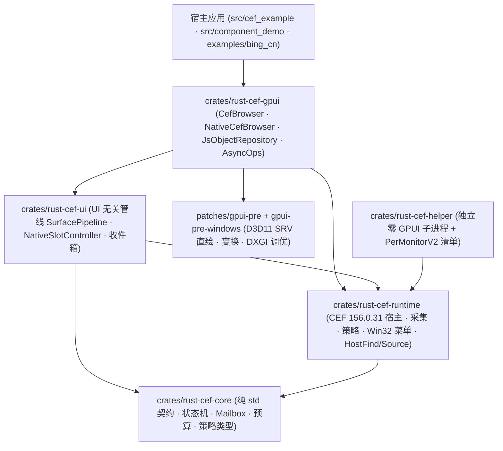
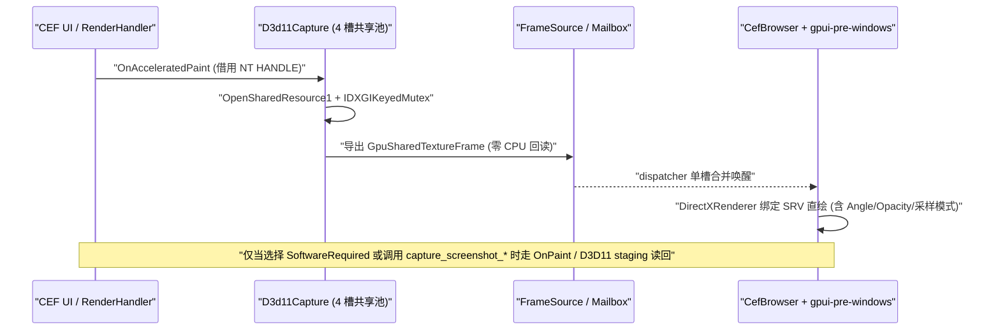

# `cef-rs-gpui` 分层架构与运行时管线

本文档按当前 **v0.2.0** 源码实现与实证状态整理（基线：Windows x64 MSVC、CEF `156.0.31+ge603d97+chromium-156.0.8078.100`、`cef-rs` `156.7.0+156.0.31` 固定提交 `7b6bf84e76e919790bd61df077e29dc4132eb5e2`、`gpui-pre =0.3.12` + [`patches/gpui-pre*`](../patches/gpui-pre)）。组件化演进的设计档案留存于 [2026-11-21 归档设计](../openspec/changes/archive/2026-11-21-componentize-gpui-cef/design.md)，后续增量规格见 [`openspec/specs/`](../openspec/specs) 及对应变更记录。

---

## 1. 宿主边界与安全模型

`cef-rs-gpui` 将 CEF 浏览器宿主、渲染采集与平台集成收敛为可嵌入组件，**宿主始终拥有 `Application`、顶层窗口、布局与退出决策**：

- **组件不篡夺进程所有权**：不在库内调用 `std::process::exit()` 或 `cx.quit()`，不修改宿主 `PATH` 或当前工作目录，也不依隐式全局静态定位器或环境变量（`START_URL` 等）创建浏览器。
- **显式唯一 `Runtime` 所有者**：进程内仅允许一个活跃 `Runtime`（再次启动返回 `StartError::AlreadyActive`），所有 Profile 与 Browser 实例统一登记并在关闭屏障排空后于初始化主线程调用一次 `cef::shutdown`。
- **可信内容模型（`no_sandbox=1`）**：当前默认禁用 Chromium 沙箱（与 CefSharp 开发形态一致），所有 HTTP(S) 导航、重定向、子资源、自定义 Scheme、弹窗、下载、权限、认证、证书例外、无头 CDP 与 JS 桥接均采用默认拒绝（fail-closed）模型，依赖 `TrustedContentPolicy` 与宿主显式 opt-in 策略门禁控制。

---

## 2. 五包分层与无环依赖



| Crate | 职责与核心约束 |
| --- | --- |
| [`crates/rust-cef-core`](../crates/rust-cef-core) | 零外部依赖纯 `std` 核心契约层：配置/ID/代际、Session/Profile 状态机、有界双表面 `mailbox` 与 256 MiB 每 Browser 像素预算、输入/快捷键/滚轮模型、JS 桥接边界、Menu/Find/SourceViews 模型、HostCapabilities Trait 与可跨平台单测的状态逻辑。 |
| [`crates/rust-cef-runtime`](../crates/rust-cef-runtime) | 零 `gpui` 依赖的原生运行时层：CEF API 哈希预检、发行/Helper 校验、`Integrated` / `Threaded` 调度、`D3d11Capture` 共享纹理池与 CPU 软件回退采集、`NativeChildHwnd` 与受管弹窗（`PopupLedger`）、`AuxiliaryResourcePolicy`（离线 DevTools）、`TrustedContentPolicy`、`CustomScheme` / `ResourceInterceptor` / `ResponseBodyFilter`、`FrameTextLedger`、`HostFindSourceBook` 与原生 Win32 `#32768` 菜单宿主。 |
| [`crates/rust-cef-helper`](../crates/rust-cef-helper) | 零 `gpui` 依赖独立子进程可执行文件，通过 `build.rs` 嵌入 Windows 10/11 兼容声明与 `PerMonitorV2` 清单（确保 GPU 子进程在打开 DevTools 等辅助窗时感知一致）；仅接受非空 CEF `--type`，无 type 直接返回退出码 `2`。 |
| [`crates/rust-cef-ui`](../crates/rust-cef-ui) | UI 工具包无关抽象层：帧消费与表面状态检查（`SurfacePipeline` / `SurfaceTarget`）、窗口绑定与绘制戳隔离（`binding`）、capacity-1 合并异步唤醒通道（`dispatcher`）、有界输入通道（`input`）、文件拖放状态机（`file_drag`）、IME 坐标投影（`ime_geometry`）、`NativeSlotController` 与 UI 中性 Find/Source 收件箱（`find_inbox` / `source_inbox`）。 |
| [`crates/rust-cef-gpui`](../crates/rust-cef-gpui) | GPUI 视图集成层：[`CefBrowser`](../crates/rust-cef-gpui/src/view.rs)（OSR）、[`NativeCefBrowser`](../crates/rust-cef-gpui/src/native_view.rs)（Win32 子 `HWND`）、统一逐视图回调（[`events.rs`](../crates/rust-cef-gpui/src/events.rs)）、`ZoomGate` 反压锁、`UiComposition`、[`JsObjectRepository`](../crates/rust-cef-gpui/src/js_repository.rs)、[`async_ops`](../crates/rust-cef-gpui/src/async_ops.rs)、IMM32 + 活跃组合期临时 1×1 caret、异步 OLE 外拖、`IDropTarget` 入站拖放与 `accesskit` UIA 投影。 |

---

## 3. 双渲染后端与低延迟管线

### 3.1 默认 OSR 零拷贝 D3D11 管线与按需读回



- **真零拷贝 GPU 直通（`D3d11Required`）**：[`capture/d3d11.rs`](../crates/rust-cef-runtime/src/capture/d3d11.rs) 在 CEF UI 线程于回调有效期内通过 `ID3D11Device1::OpenSharedResource1` 与 `IDXGIKeyedMutex` 将 CEF 借用纹理同步至 4 槽共享纹理池（`SHARED_TEXTURE_SLOT_COUNT = 4`），以只读租约（`SharedTextureSlotTracker`）经 `Mailbox` 交付至 GPUI。借用句柄在回调内不缓存、不跨线程传递、不擅自 `CloseHandle`。
- **GPUI 直绘扩展（[`patches/gpui-pre*`](../patches/gpui-pre-windows)）**：`DirectXRenderer` 直接消费 D3D11 `ID3D11ShaderResourceView`，并原生支持表面旋转角（`-180°..+180°`）、不透明度（`Opacity`）及 `Linear` / `NearestNeighbor` 缩放采样模式；同时显式设置 `IDXGIDevice1::SetMaximumFrameLatency(1)` 与双缓冲 `DXGI_SWAP_EFFECT_FLIP_DISCARD`（支持 `FLIP_SEQUENTIAL` 回退）。
- **显式软件回退与预算防护**：`RenderPreference::SoftwareRequired` 走 `OnPaint` 拷贝路径；无论哪种路径，`FrameSource` 均受每 Browser `256 MiB` 逻辑 CPU 像素预算（`Arc<BudgetedPixels>`）与 VIEW/POPUP 双表面分离管控，失败保留最后好帧。`capture_screenshot_bgra` / `capture_screenshot_png` 仅在显式请求时从最新帧或按需 CEF-UI D3D11 staging 读回像素。

### 3.2 Opt-in Win32 原生子窗口后端（`NativeChildHwnd`）

- 创建前在 `rust-cef-core` 校验 `PixelRect` 坐标与尺寸上限（`MAX_NATIVE_COORD = 1_000_000`、`MAX_NATIVE_BOUND = 16384`）及宿主 `IsWindow(parent_hwnd)` 有效性；
- 通过 `WindowInfo::set_as_child`、`RuntimeStyle::ALLOY`、`windowless_rendering_enabled = 0` 与 `shared_texture_enabled = 0` 创建浏览器（`Client::render_handler()` 返回 `None`，零 OSR 资源分配）；
- 创建阶段按需附加 `WS_EX_NOACTIVATE` 并于 `on_after_created` 剥离，避免抢占宿主焦点；
- **关键关闭协议**：`RuntimeLifeSpanHandler::do_close` 对 `NativeChildHwnd` 返回 `1` 并投递 `TaskPayload::DestroyNativeChildHwnd` 在 CEF UI 线程销毁子 `HWND` 触发 `on_before_close`，避免 CEF 向宿主顶层父窗投递 `WM_CLOSE`；
- **Airspace 限制**：Win32 子窗口独立合成，GPUI 无法直接叠画在其之上；切走非激活标签或弹出 GPUI 模态框时须隐藏子 `HWND`（`SW_HIDE` + `0x0` 尺寸）。

---

## 4. 交互、DPI 解耦缩放与 Resize 恢复

- **`ZoomGate` 单飞帧回执反压锁**：网页缩放（`25%–500%`）只调用 `CefBrowserHost::set_zoom_level`，不触发 `was_resized()` 或 `notify_screen_info_changed()`，彻底与系统显示器 DPI 解耦且 D3D11 共享池零重建。突发滚轮/捏合缩放先更新期望档位并合并在途请求，待 CEF 提交新帧（`frame_seq > sent_seq`）或触发 `120ms` 静态页兜底后再发送最终档位。
- **高频输入与无闪烁缩放**：鼠标移动通过 `GetMouseMovePointsEx` + `FastMouseMoveQueue` 补齐合并；滚轮经 `ScrollWheelAccumulator` 精确累加；窗口拖拽边框由 `WM_CEF_SIZEMOVE_PRESENT` 协调；触控与捏合经 `NativeTouchServices` / `PinchEvent`；文本输入仅走一条提交路径避免重入双字。
- **有界 Resize 恢复与多刷新率**：`recommended_windowless_frame_rate()` 按主屏刷新率夹紧至 `120..=240 Hz`；缺帧恢复受限于最短 `100ms` 间隔、每目标代际最多 `8` 次 `Invalidate`，耗尽后报告 `CaptureFailureKind::ResizeExhausted`。

---

## 5. 并发模型、状态机与跨边界桥接

```mermaid
stateDiagram-v2
    [*] --> NotStarted
    NotStarted --> Starting: "Runtime::start (部署校验 + API hash)"
    Starting --> Ready: "CefInitialize 成功且 ContextReady"
    Starting --> ProcessExitRequired: "CefInitialize 返回 false (立即退出进程)"
    Ready --> Draining: "request_shutdown (停止新请求 + 关闭所有 Browser)"
    Draining --> Stopped: "所有实例 OnBeforeClose + 请求/档案归零 + finish_shutdown"
    Draining --> ShutdownBlocked: "超时或调度阻塞 (仅诊断，不提前销毁)"
    ShutdownBlocked --> Draining: "继续 poll_shutdown"
    Stopped --> [*]
```

- **线程模型**：`Integrated`（主线程手动 pump，需保证在 GPUI 可变 `App` 借用外执行）与 `Threaded`（CEF 自驱 UI 线程，无手动 pump）共享同一命令队列、实例代际验证与关闭屏障。
- **状态正交分离**：Browser 生命周期（`Creating`/`Alive`/`Closing`/`Closed`/`CreateFailed`）、页面加载（`NavigationSnapshot`）、Renderer 活性（`Starting`/`Running`/`Unresponsive`/`Terminated`）与两阶段 `BeforeUnload`（`Closing` 被拒绝时发 `CloseCancelled` 恢复 `Alive`，不改写旧 `Cancelled` ticket）各自独立记录，不混为一谈。
- **`RuntimeBrowserBridge`**：随一次性 `BrowserAttachment` 挂载 `Weak<UiRegistry>` 与 `BrowserId`（零 GPUI 类型），支撑 `CefBrowser` 与 `NativeCefBrowser` 在不修改 `rust-cef-core` 的前提下安全向 CEF UI 线程发起 `Frame::source`/`Frame::text` 读取（`FrameTextLedger`）、OSR D3D11 截图读回及瞬态无头 CDP `Page.captureScreenshot`。

---

## 6. 策略边界、查找/源码与 JS 桥接

- **导航与资源边界**：`TrustedContentPolicy` 在初始 URL、重定向、子资源、自定义 Scheme（`SchemeHandlerFactory` 含符号链接与 NTFS reparse point 穿透防护）与 `CefURLRequest` 均执行规范化校验；通过 `ResourceInterceptor` 与 `ResponseBodyFilter` 支持允许源上的流式响应体改写。
- **有界严格串行 Find 与 View Source**：
  - 支持右键菜单（`FindScope::Menu`）与宿主直调（`FindScope::Host`：`Runtime::find` / `Runtime::stop_finding` / `Runtime::view_source`）两条入口，共用同一套 `Finds` / `SourceViews` 状态机；
  - `Finds` 严格维持每 Browser 至多 1 个活跃操作、高水位序号过滤（`identifier <= highwater`）与未知回调隔离（`quarantined`）；针对 **CEF `156.0.31` `FindTabHelper::StartFinding` 在 `findNext = 0` 返回 `active_ordinal == 0`** 的实证差异，宿主新查找先执行 `host.stop_finding(0)` 再以 `1` 触发首次查找，同时 `TaskPayload::HostStopFinding` 携带 `cutoff_sequence` 防止 CEF UI 执行延迟取消新近入队的后续 `host_find`。
- **JS Object Repository & `window.rustCef`**：冻结只读 `window.rustCef`（256 KiB / 32 层深度 / 同源门禁）+ `policy_native::JsRepositorySettings` + renderer V8 bootstrap（`jsb_bridge_js.rs`）+ 宿主 `JsObjectRepository`（`BindObjectAsync`、`DeleteBoundObject`、`IsObjectCached`、`RemoveObjectFromCache`、`PostMessage`、`__cefCbId` 回调、`JsDate` 与延迟 RPC）。
- **受管 DevTools 与扩展能力**：`AuxiliaryResourcePolicy` 仅放行离线 `devtools://devtools/bundled/...`、`devtools://theme/...`、`devtools://resources/...`，并追踪 `has_dev_tools()` 真实关联状态与父 Browser 关闭联动清理。

---

## 7. CefSharp `156.0.15` 参考边界与版本差异

项目以本地 CefSharp `156.0.15`（HEAD `41919703`）为结构与 Handler 协议模板，但不照搬其 WPF Dispatcher 隐式调度、静态 `Cef` 门面、GC 驱动销毁或未受管弹出窗口；与锁定 **CEF `156.0.31`** 的具体代码差异清单（`Find` `find_match`、`GetSourceAsync`/`GetTextAsync` `JsFrameScope`、`NativeChildHwnd` `DoClose`、混合模式下 `Integrated` DevTools、`NativeCefBrowser` 截图前置 `headless_cdp_enabled` 及 CEF 156 运行时 234 项清单）统一维护于 [SDK 接入指南 §7](sdk-guide.md#7-cef-156031-vs-cefsharp-156015-%E5%AE%9E%E8%AF%81%E5%B7%AE%E5%BC%82%E9%80%9F%E6%9F%A5)。
