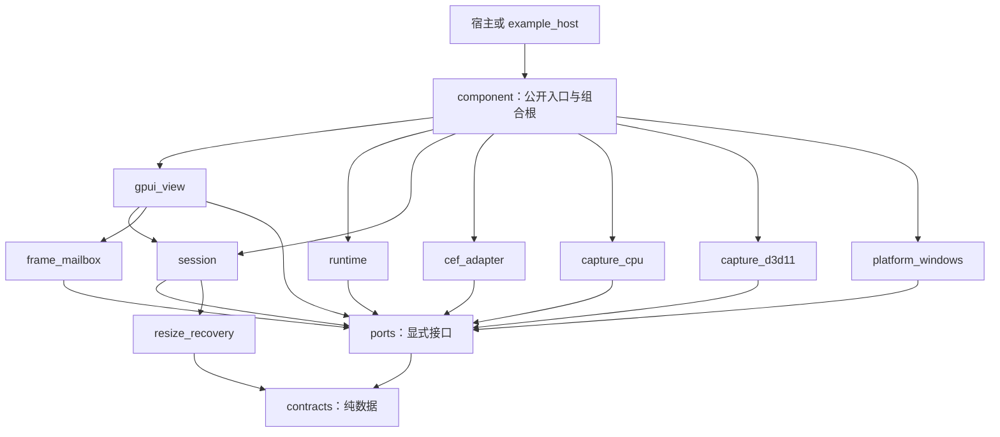
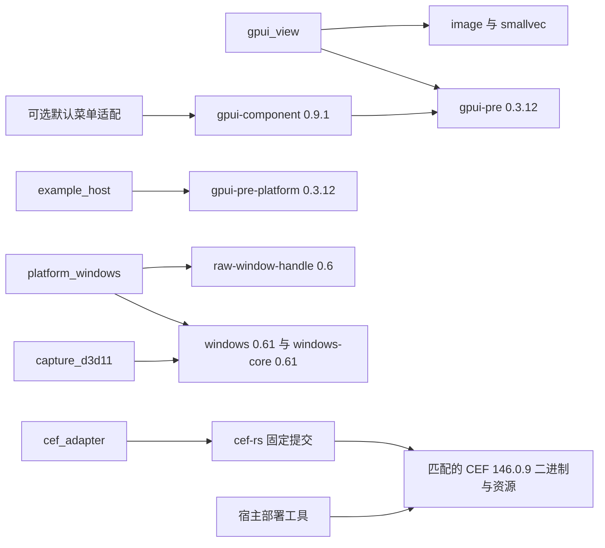
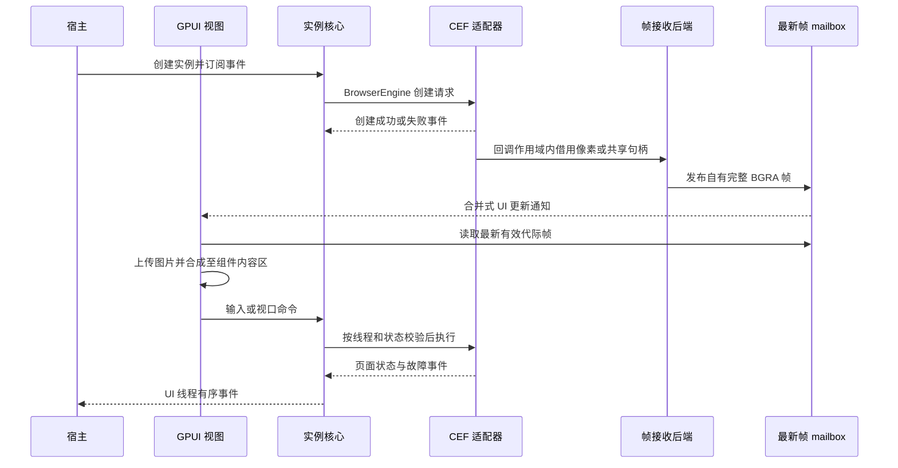
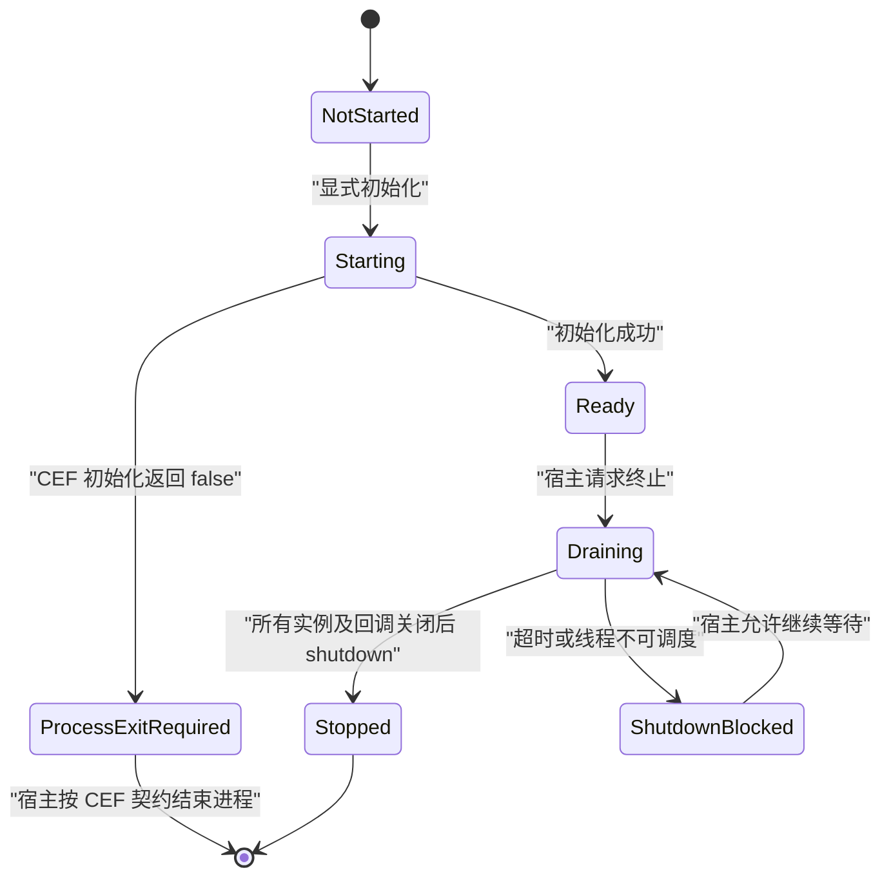

# GPUI-CEF-COMPONENT 目标架构与管线

状态：按已确认方案实施完成并已归档，2026-11-21。首版平台、独立helper、双线程、基础交互与可选独立profile/双存储已确认；各项仅凭实际任务与证据验收。最新逐阶段方案、规格与任务以 [componentize-gpui-cef](../openspec/changes/archive/2026-11-21-componentize-gpui-cef/design.md) 及 `openspec/specs/` 主规格为准，确认项与旧建议的替代关系见 [首版交付笔记](../.agents/notes/implemented/architecture/2026-11-11-component-delivery-baseline.md)。组件名称为 **GPUI-CEF-COMPONENT**；下文描述目标契约，其中core基础已有实现，Native与视图接口仍按后续任务落地，不能把设计图当完成证据。根PoC包名仍为gpui-cef-poc，已新增四包workspace；没有升级既有外部依赖。

现状见 [项目结构说明](project-structure.md)，历史实测见 [验证记录](validation.md)，取舍见 [组件化决策草案](../.agents/notes/implemented/architecture/2026-11-11-gpui-cef-component.md)。本文替换早期固定视口、GPUI 0.2.2 和无共享纹理的架构说明，不把目标能力表述为已实现。

用户已确认参考 CefSharp.Wpf 的分层和生命周期机制。固定版本证据及适配边界见 [CefSharp.Wpf 参考笔记](../.agents/notes/implemented/architecture/2026-11-11-cefsharp-wpf-reference.md) 和本文第 10 节；这不表示整体移植其线程、全局管理或渲染实现。

## 1. 目标、范围与宿主边界

目标是让 GPUI 宿主能在自己的视图树中嵌入一个或多个 `CefBrowser`，不必复制本 PoC 的入口、窗口、计时器、自测或全局环境约定。可运行的判据是：独立示例宿主能完成子进程分流、初始化、嵌入、导航、输入、尺寸/DPI 更新、多实例隔离和全部实例关闭，而不依赖示例内部类型。

| 组件提供的能力 | 边界 |
| --- | --- |
| GPUI `CefBrowser` 视图适配 | 接入宿主已创建的窗口与布局，不创建或接管宿主 Application |
| 实例控制与状态 | 拟提供导航、前进、后退、刷新、停止加载、焦点、可见性及关闭；命令接收不等于操作完成 |
| 网页显示与输入 | OSR 帧接收、GPUI 合成、鼠标/键盘/IME、视口/DPI、光标；不暴露裸 CEF 对象给普通宿主代码 |
| 页面与故障事件 | 地址、标题、历史可用性、加载阶段、加载错误、渲染进程故障及恢复结果；不保证百分比加载进度 |
| 进程级接入工具 | 提供受控 Runtime 初始化、子进程分流和关闭协调；宿主必须显式接线，不能仅创建 View 就自动完成进程级初始化 |
| UI 请求 | 菜单、IME 定位、导航策略等通过显式接口适配；CEF 回调只能由其所属实例和请求令牌回答一次 |

宿主拥有 Application、顶层窗口、布局、快捷键策略、应用退出决策、运行时文件部署、缓存/用户数据目录、安全策略和发布更新。组件拥有各 Browser 的协议正确性、回调处理、内部资源及状态，不承担导航栏、标签管理、会话恢复产品策略、账号体系、任意脚本桥、下载管理或应用级权限 UI。新窗口、下载、权限、证书例外、外部协议不得在未设计时隐式放行；未支持能力需显式拒绝或报告 `Unsupported`，不能使用 CEF 默认弹窗代替策略。

组件不调用 `process::exit()`、`cx.quit()`，不修改宿主 PATH/工作目录，不默读 `POC_*`/`START_URL`，不依赖“第一个窗口”。底层 CEF 自身具有进程级状态；“禁止隐式全局状态”约束组件的访问方式，并不意味着能把 CEF 变成可随意重复初始化的普通实例。推荐进程内只有一个显式 Runtime 所有者，所有 Browser 通过它注册；已有其他 CEF 初始化者时应拒绝冲突，暂不承诺附着到外部 Runtime。

首版平台已确定为Windows x64 MSVC、可信内容组件，不承诺Linux/macOS或生产sandbox。采用宿主显式路径的独立helper；两种CEF线程模式均为首版必需能力，分别在独立进程验收。

## 2. 分层、模块与组合根

以下为目标逻辑模块。core/runtime/component/helper四个Cargo包边界已创建，并保留PoC名称；core配置/代际/创建基础和端口已有纯std实现，runtime发行预检/子进程入口、真实helper及打包工具已有实现，见[部署决定](../.agents/notes/implemented/architecture/2026-11-11-component-runtime-deployment.md)；双模式最小Native启动/异步创建/软件帧路径已实际运行，接纳门/原生引用清理、全实例关闭与最小GPUI分发已通过G1组合实跑，见[原生生命周期决定](../.agents/notes/implemented/architecture/2026-11-11-native-runtime-probe.md)；默认与命名Memory profile已通过双模式同源共享/隔离实跑；Persistent目录/租约/重启、产品view与完整输入/渲染仍在后续任务，G1或内存profile通过不等于组件发布。具体路径及验证以OpenSpec design、当前项目结构和validation.md为准。产品显示名为GPUI-CEF-COMPONENT，Rust包gpui-cef-component尚未作为完整组件发行。

| 层 | 拟议模块 | 一句话职责 |
| --- | --- | --- |
| 组合层 | `component` | 公开入口与组合根，按配置构造具体适配器并注入核心，不实现业务状态机 |
| 适配层 | `gpui_view` | 把 GPUI 布局、输入和绘制转换为组件命令、事件与帧消费 |
| 核心层 | `runtime` | 管理进程级状态、调度资格、实例注册、关闭屏障与全局终止顺序 |
| 核心层 | `session` | 管理单个 Browser 的命令、状态、导航与关闭状态机 |
| 核心层 | `frame_mailbox` | 提供有界最新帧发布、消费及帧代际过滤 |
| 核心层 | `resize_recovery` | 在无匹配尺寸帧时进行限频、有次数上限的刷新请求 |
| 契约层 | `contracts` | 定义与 GPUI/CEF 无关的 ID、配置、命令、事件、错误和帧描述 |
| 契约层 | `ports` | 定义 Runtime、Browser 引擎、调度、帧接收与宿主服务所需接口 |
| 后端适配层 | `cef_adapter` | 实现 RuntimeDriver/BrowserEngine，并把 CEF 回调翻译为自有数据和事件 |
| 后端适配层 | `capture_cpu` | 在 CEF 软件绘制回调有效期内复制并验证 BGRA 帧 |
| 后端适配层 | `capture_d3d11` | 在加速回调有效期内打开共享纹理、复制并回读为自有 BGRA 帧 |
| 平台适配层 | `platform_windows` | 实现窗口服务接口，封装 HWND 借用、IME 定位及必要 Win32 能力 |
| 示例层 | `example_host` | 展示 Application、入口分流、Runtime 接线、窗口及退出协调，承载演示和自测 |

### 2.1 模块级依赖图

箭头只表示“编译期依赖”，不是运行时事件方向。`ports` 中接口由消费者定义，适配器实现，组合根注入。不能把返回事件误画成对上层实现的依赖。

约束：`contracts` 不依赖任何上层或外部 UI/浏览器库；核心不依赖 `cef`、`gpui`、Win32 或组合根；后端不导入 `gpui_view`；`gpui_view` 不调用 CEF Host；各后端之间不互相获取具体实现；仅组合根知道所有具体适配器。`cef_adapter` 通过 `FrameCapture` 使用被注入的 capture 实现，capture 通过 `FrameSink` 发布帧，不能直接查找 View。`runtime` 通过注册令牌与关闭端点协调实例，不持有 View 或依赖具体 session 实现。

跨模块不共享可随意修改的“大 Channel”；共享字段收敛为只读快照、命令入口和内部有界 mailbox。组件状态存放在显式 Runtime/Session 实例中，不通过 `static`、线程局部或 GPUI 全局注册表隐式检索。

### 2.2 可替换接口清单

接口职责是目标约定；实现前必须结合 GPUI 执行器和固定 CEF 绑定确定签名、线程资格与对象安全性，不预设存在对应库 API。

| 拟议接口 | 调用方 / 实现方 | 所有权与结果约定 |
| --- | --- | --- |
| `RuntimeDriver` | runtime / cef_adapter | 初始化/shutdown固定应用主线程；仅Integrated执行主线程pump；Threaded无手动pump；helper独立执行子进程分流 |
| `BrowserEngine` | session / cef_adapter | 按实例执行创建、导航、输入、视口和关闭；不返回裸 Browser/Host |
| `BrowserEventSink` | cef_adapter / 核心事件收件端 | 接收自有事件；不在 FFI 回调中直接执行任意宿主代码 |
| `FrameCapture` | cef_adapter / capture_cpu 或 capture_d3d11 | 仅在回调作用域借用像素或句柄；必须在返回前完成必要拷贝和同步 |
| `FrameSink` / `FrameSource` | capture 与 gpui_view / frame_mailbox | 发布自有不可变帧、读取最新帧；只保留有界快照与在途消费引用 |
| `UiDispatcher` / `PumpScheduler` | 核心 / GPUI 调度适配 | 投递 UI 工作、预约/取消唤醒、返回可停止令牌；禁止直接在后台执行 CEF pump |
| `NativeViewServices` | gpui_view / platform_windows 或宿主实现 | 以窗口绑定令牌提供 IME、屏幕坐标和窗口有效性；只借用 HWND，不拥有或销毁窗口 |
| `ContextMenuPresenter` | gpui_view / 默认适配或宿主实现 | 自有菜单模型加一次性响应令牌；关闭、失焦、替换时保证终结请求 |
| `NavigationPolicy` | session/cef_adapter / 宿主注入策略 | 同步给出快速允许/拒绝；不得等待 UI、网络或阻塞 Future；异步咨询须取消本次后重新发起 |
| `DiagnosticsSink` | 各层 / 宿主或空实现 | 接收结构化诊断；不阻塞回调，不通过改页面标题传递内部状态 |

宿主不能替换为违反 CEF 契约的任意线程执行器；可替换的是调度实现，不是线程规则。菜单默认适配是否依赖 `gpui-component` 待确认；核心与基础 BrowserView 不应强制要求宿主采用该组件库、主题或 Root 包装。

### 2.3 外部依赖与接入位置

| 外部项 | 当前基线 | 目标接入约束 |
| --- | --- | --- |
| GPUI | `gpui-pre =0.3.12` | 初期沿用精确版本；宿主和组件必须使用同一 GPUI 类型身份，不提供 0.2.2/0.3.12 双版本桥 |
| 平台入口 | `gpui-pre-platform =0.3.12` | Application 启动留在示例/宿主；组件不私建 Application |
| 菜单组件库 | `gpui-component =0.9.1` | 如保留默认菜单适配，与 GPUI 一起锁定、升级；是否拆可选 feature 待确认 |
| CEF 绑定 | 提交 `02cd5a01abb9db835549b3632cbf93ee73323e56`，既有记录为 `146.4.1+146.0.9` | 初期不升级；准确 Cargo 解析以锁文件为准，API 哈希选择封装在 cef_adapter |
| CEF 二进制 | `.cef/146.0.9_windows_x86_64` | 与绑定、架构、API 版本、资源及 locales 作为配套部署单元，不混用不同版本 |
| Windows 绑定 | 当前清单 `windows =0.61`、`windows-core =0.61` 的兼容范围 | 初期沿用，根锁文件锁定实际补丁；不能因旧提案写了 0.58 就视为已降级；native 类型不穿越公共接口 |
| 其他 | `image 0.25`、`smallvec 1.15`、`raw-window-handle 0.6` | 目前不是精确版本约束，实际解析看锁文件；只留在必要适配层 |
| 渲染后端 | 软件BGRA、D3D11回读后上传GPUI图片 | 两后端均纳入双模式首版验收；请求Required后端时不得静默降级计通过；零拷贝仍另需验证 |

组件库的 Cargo.lock 不会约束下游宿主的整个解析结果，不能只靠提交本仓锁文件保证兼容。交付时需要公开支持矩阵、必要的精确依赖要求和宿主编译验证。D3D11 零拷贝必须有已验证的 GPUI 导入接口、设备兼容和同步契约才能启用，不列为首版已支持能力。

CEF DLL 缺失可能发生在进入 Rust main 之前，组件的初始化错误 API 无法捕获操作系统加载器阶段失败；部署检查与启动器承担这一层。仓库 `.cargo/config.toml` 的 runner 不会自动成为下游宿主配置；当前按 exe 名匹配的 staging 脚本必须改为显式宿主产物部署工具。运行时不下载或覆盖 CEF。

## 3. 分阶段管线与控制流

### 3.1 进程入口、初始化与调度

宿主在应用主线程显式接入Runtime并提供独立helper绝对路径，不将自身exe作为子进程回退。helper入口执行api_hash/execute_process并返回真实退出码，不启动GPUI或再次initialize。首版明确发行布局和资源校验，空/相对/不匹配helper在初始化前拒绝；路径存在不等于已完成DLL部署验证。

主线程接收显式 `RuntimeConfig`：资源/locale/helper 路径、缓存策略、sandbox、渲染偏好和调度配置。先验证可验证的路径与版本，再进行 API 哈希选择和 CEF initialize。调用前的配置校验失败可以返回结构化错误，宿主修正后重新校验。真正 `CefInitialize` 返回 false 则不同：本地 CEF 头文件要求应用立即退出，除可选 `CefGetExitCode` 外不得再调用 CEF，也不调用 shutdown；组件返回拟议的 `ProcessExitRequired` 结果，由宿主入口履行终止契约，不能继续正常运行或同进程重试。返回 false 也可能是正常早退，不一律归为故障。只有初始化成功后才能签发 Runtime 令牌；成功 shutdown 后同进程重启也不在支持承诺内。

首版同时支持Integrated（multi_threaded_message_loop=0）和Threaded（=1），启动必选且不能热切换。前者GPUI与CEF UI同线程，使用可停止、合并唤醒、无GPUI借用重入的主线程pump；现有8ms ticker/1ms检查只作起点。后者CEF自驱UI线程，禁止任何manual pump，状态/IME更新通过独立GPUI分发而不依赖pump。两模式initialize/shutdown都在应用主线程。external message pump不是双模式支持的必要前提，暂不另引入第三策略。

### 3.2 Browser 创建与绑定

宿主选择配置和绑定窗口，组合根创建Session、事件端点、frame mailbox与独立CEF Client。Runtime先登记创建中令牌，再统一异步创建；两模式均以OnAfterCreated确认就绪，不保留主线程同步创建的第二实现路径。请求接受、Browser就绪、页面加载和首帧是独立事实，迟到创建成功也纳入关闭注册表。

实例配置包含初始地址、可选ProfileHandle、视口和渲染偏好。profile未填则绑定Runtime默认共享context；显式profile由Runtime注册独立context，多个Browser可选同一个来共享。宿主显式选择Memory或Persistent；目录和root独占约束见design。承诺存储上下文隔离，不承诺独立Runtime或安全沙箱；CEF自己的renderer分配规则另依契约，禁single-process。创建失败终结登记；创建中收到关闭后若迟到成功，必须立即关闭而不泄漏。

### 3.3 渲染输出与合成

软件路径在 `OnPaint` 返回前验证宽高、总字节数、像素格式并复制借用缓冲。加速路径在 `OnAcceleratedPaint` 内打开共享资源并完成复制、同步及必要回读；不把 CEF 原始共享句柄放入异步队列。现有实际代码在回调内同步 Map/readback，虽然 d3d11_receiver 的部分注释谈到延后读取，目标基线以实际调用为准。改变为后台回读需要独立自有纹理、完成同步和设备线程契约的验证，不能仅把现有函数移到 worker。

发布帧至少携带 Browser ID、实例代际、帧序号、物理尺寸、格式和相关视口元数据。视口代际如何与延迟 CEF 回调可靠关联待验证，不能拿“回调时的最新视口”伪装为该帧生产代际。初期以成功复制且符合目标像素尺寸的完整帧作为 resize 确认依据；同尺寸旧内容不能仅凭尺寸证明新导航或新布局完成。

mailbox 保留最新帧，不累积视频队列；视图只对新序号更新，旧 GPU atlas 图片按 GPUI 资源接口释放。预算同时覆盖最新帧、消费者持有帧和 staging，不把“单槽”误当总内存恒定。初期沿用有上限的完整帧，不做未验证的 dirty-rect 局部合成。

合成必须区分网页 VIEW 和 OSR POPUP 绘制层；下拉选择框等 POPUP 不等于新 Browser 弹窗。现状只记录 popup 可见性且忽略非 VIEW 帧，不能宣称下拉框已支持。目标把 popup surface、原点、裁剪和输入命中纳入同一视图合成；未实现前在能力矩阵标为不支持，而不是作为普通网页无条件验收通过。缩放过渡继续遵守已验证的 1:1 像素绘制/裁剪原则，不拉伸旧帧掩盖捕获停滞。

### 3.4 输入、焦点、菜单与 IME

GPUI 命中测试先区分宿主覆盖层、菜单、popup surface 与网页。视图把窗口坐标转成组件局部 DIP，键位/修饰键转换为契约层输入数据，经 Session 的状态和实例校验后由 BrowserEngine 调用 CEF。鼠标按下/抬起、按键、IME 和 drag/drop 保持顺序；移动可在不跨按键边界时合并。输入在实例尚未就绪或已关闭时明确拒绝，不静默排队到未来的新页面。

焦点由宿主窗口激活及组件 FocusHandle 共同决定，不在每帧抢焦点；失焦不等于隐藏，不停止网页出帧。指针捕获与组件外抬起、焦点转移的按键清理需建立回归，不假定当前所有情况已覆盖。

文本只走一条提交路径，避免同时发送字符键和 `ImeCommitText` 双重输入。CEF 报告的 caret 转为窗口绑定坐标，通过 `NativeViewServices` 在 UI 线程定位候选窗；不同窗口/实例不能共用“第一个窗口”的 DPI。菜单模型在 CEF 回调有效期内复制，callback 留在后端，由请求令牌映射；宿主只见菜单数据和响应入口。每个请求无论选择、取消、替换、关闭还是超时都恰好终结一次。

文件拖入沿用 enter/over/drop 的分阶段语义；真实 OS 拖动与测试探针分离。网页向外 OLE 拖出默认不纳入稳定能力，避免把已知可能阻塞的嵌套消息循环引入宿主。

### 3.5 窗口尺寸、DPI 与可见性

GPUI prepaint 得到组件内容边界与所在窗口 scale，发出 `ViewportUpdate`；Session 合并尚未执行的尺寸更新，CEF 适配器设置 DIP view rect 和 screen info，并按要求通知 resize/DPI。物理像素尺寸由 DIP 与缩放计算，不把窗口外框尺寸当网页尺寸。

隐藏、最小化、零内容区域与失焦分别处理；隐藏时暂停无意义恢复请求，显示后重新要求有效帧。保留现有 resize 恢复的限频/限次不变量：当前基线每 100 ms 至多一次、目标至多 8 次，完整匹配帧才确认，坏 letterbox 帧不覆盖好帧。耗尽后报告捕获停滞，不无限 invalidate，不自动重新初始化整个 CEF。

### 3.6 导航、加载与状态观察

宿主命令转换为 BrowserEngine 的主 frame 导航、历史操作、刷新或停止。页面内链接和脚本导航也经过后端的导航策略入口，不仅过滤公开 `navigate`。新 Browser 请求须显式拒绝或交回宿主创建受注册的组件实例，不允许默认创建未管理窗口。

CEF 的 Display/Load/Request/LifeSpan handlers 汇总为类型化事件。建议状态快照包含地址、标题、loading、can_go_back/forward、主 frame 加载错误、渲染存活状态；主 frame 与子 frame 事件明确区分。导航命令 ID、CEF frame ID 与本地事件序号只能表达各自已知因果；重定向、取消、页面自发导航和多 frame 并发下，不承诺所有回调都能映射到唯一宿主导航 ID。主 frame 导航代际的具体生成规则待实现验证。

加载成功、浏览器就绪、收到首帧、renderer 可响应是独立事实。当前源码只完成首次 URL、标题和部分交互回调，并未实现上述完整导航/加载 API；不得通过标题探针冒充公共状态。

### 3.7 实例关闭与 Runtime 终止

单实例关闭停止接收新命令，取消菜单/待回答请求与拖放，注销 UI 通知，并由引擎异步请求 Browser 关闭。普通关闭与强制关闭要区分 beforeunload 等页面行为，策略与超时由宿主配置；组件不得默认以强制关闭替代正常协议。

runtime持有所有创建中和活跃实例注册表；终止时拒绝新实例并逐一关闭。Integrated继续主线程pump，Threaded保持自驱loop并异步检查；两者都等所有Browser的OnBeforeClose，再清除Browser/Client/请求强引用和已接纳任务。仍可能迟到的 IO 请求回调必须访问有效的关闭墓碑/事件收件端，而不能访问已释放 View。所有 CEF 对象释放、任务与回调退场的屏障完成后，才在初始化主线程调用 shutdown；然后撤销唤醒、停止/回收自有 ticker。调度器须持续到关闭屏障完成，不能先销毁 GPUI 执行器再依靠它关 Browser。

关闭超时返回 `ShutdownBlocked` 与未关闭实例清单；不提前 shutdown、不释放仍被回调使用的原生状态，不在库内退出或杀进程。宿主可继续等待，或按明确策略结束整个应用；不存在安全的“强制 Drop 后继续正常运行”承诺。单纯 Drop 只可触发非阻塞关闭请求，不能作为异步关闭完成证明；公开使用说明必须要求显式关闭/关闭屏障。

## 4. 并发、所有权与状态机

### 4.1 线程归属

| 执行位置 | 职责与限制 |
| --- | --- |
| 宿主应用主线程/GPUI UI | GPUI、Runtime init/shutdown、Win32 IME及GPUI图片；仅Integrated同时为CEF UI并执行pump，Threaded不在此执行CEF UI任务 |
| CEF UI命令序列 | 两模式统一处理Browser/profile/原生请求状态；Integrated位于主线程，Threaded位于CEF自有UI线程；统一路由是本项目顺序治理，不是全部Host方法的SDK硬限制 |
| CEF Render/LifeSpan UI 回调 | 按本地 CEF 146 头文件属于 CEF UI 线程；复制/翻译数据后入队，不持有 GPUI App 可变借用，不重入宿主事件处理 |
| CEF IO 等内部线程 | 网络相关回调依各自 CEF 接口约定执行；只访问线程安全的自有数据端点，不操作 GPUI/窗口，也不阻塞等待 UI |
| CEF renderer/GPU/utility 子进程 | 由 CEF 管理执行；不是组件自建工作线程，不把其对象引用跨进程传给宿主 |
| Integrated可选ticker | 只发可合并唤醒，有停止/回收协议，不直接pump或操作GPUI/Browser；Threaded不启动该pump ticker |
| 可选诊断 worker | 处理自有日志记录和文件 IO；不携带 CEF 借用缓冲、原始 HWND 或线程绑定 COM context |

本地头文件确认 `CefInitialize/CefShutdown/CefDoMessageLoopWork` 的主线程要求，`CefRenderHandler`/`CefLifeSpanHandler` 的 UI 线程契约及 `CefRequestHandler` 按方法区分 UI/IO。现有源码若干注释互相矛盾，且未看到线程资格断言；目标必须加线程检查和实机线程 ID 验证。不能把所有 CEF 回调都概括成 UI 回调，LoadHandler 在其他进程的使用也有不同线程契约。

### 4.2 跨界消息规则

所有消息带稳定 Browser ID、实例代际和本实例序号；关闭后旧代际事件丢弃或只作诊断，不投递到复用后的新实例。只有自有、可发送的数据跨线程；原生 Browser/Client/回调/COM immediate context 保留在规定线程并封装，不能因 `Arc` 或锁存在就推断 `Send/Sync` 合法。

控制命令走有界队列，满时同步返回 `Backpressure`；关闭有独立保留槽/关闭标记，不会被鼠标洪流饿死。按键、按钮、IME、菜单响应不丢弃或重排；视口/移动可按语义合并；帧走独立最新帧 mailbox。关键生命周期事件保留专用容量和可查询终态，不因帧或诊断洪流丢失，宿主收到溢出报告后可读取快照重同步。具体容量和唤醒接口待测定。

CEF 同步决策回调不能阻塞等待另一个线程。可延后的 CEF callback 仅在其接口明确允许时保存，借助后端请求表和一次性令牌完成；不能概括为“所有回调都异步”。锁仅用于短临界区；调用 CEF、宿主策略、事件消费者前先释放锁。pump、事件分发与 UI 更新分开，避免 FFI 回调重入 GPUI 借用。

### 4.3 状态分离

Runtime 不画 `Stopped → Starting`，避免暗示同进程可重启。Session 生命周期为 Creating/Alive/Closing/Closed/CreateFailed；页面响应/进程状态为 Healthy/Unresponsive/RendererTerminated，显示端状态另记 SurfaceReady/SurfaceLost，加载状态独立记录。renderer 崩溃不自动等于 Browser 已关闭，网页加载错误也不等于 Runtime 故障。

## 5. 资源生命周期

| 资源 | 创建、持有与释放边界 |
| --- | --- |
| Application/顶层窗口 | 宿主创建并持有；组件只借用窗口绑定能力，绝不销毁宿主窗口；宿主退出需先满足 Runtime 关闭协议 |
| Runtime 与调度器 | 宿主显式创建一个 owner；Runtime 管实例注册与驱动资格；所有实例终止后 shutdown，随后注销任务并停止/回收 ticker |
| Browser/Host/Client/handlers | 每实例后端持有；Session 只见引擎端点；`OnBeforeClose` 前保持存活，之后清空所有 Browser 强引用，不只 drop 一个局部变量 |
| 回调请求 | 引擎请求表持有原生 callback，宿主仅持令牌；响应、替换、超时和关闭时一次性终结，禁止锁内执行 callback |
| 软件回调缓冲 | CEF 借出，回调返回前复制；组件不能释放 CEF 缓冲或在回调外读取 |
| CEF 共享纹理句柄 | CEF 管理，按加速回调契约借用；不假定拥有 CloseHandle 权限，不把借用包装为宿主 OwnedHandle |
| 自有 D3D11 device/context/staging | capture 后端创建并限定线程使用；尺寸/格式变化重建 staging；完成在途复制/Map/Unmap 后释放，设备丢失则废弃这一代资源 |
| frame mailbox 与 CPU 帧 | 引擎/capture 发布自有帧，View 持快照；关闭先断发布、通知与消费，再释放剩余引用；限制总预算 |
| GPUI RenderImage/atlas/popup surface | View 所在窗口/UI 线程持有；新帧替换、解绑或关闭时通过 GPUI 释放；若窗口已销毁，依已验证的 GPUI teardown 路径处理，不调用失效 Window |
| HWND/IME/caret | NativeViewServices 借用窗口句柄；临时 caret 只销毁自己创建的实例，不销毁宿主原有资源；窗口解绑取消候选定位 |
| CEF 子进程与句柄 | CEF 负责启动/结束及其内部句柄；组件不能因得到 PID 就宣称拥有 kill/CloseHandle 权限；如未来显式启动 helper，只有自有 Process handle 按其创建契约释放 |
| 缓存/用户数据目录 | 宿主配置；Runtime 独占规则明确后使用，shutdown 完成后才可按策略清理；不默认删除持久 profile 或别的实例数据 |

现状的清理缺口包括：额外实例没有纳入主实例退出等待、BrowserChannel 仍持 Browser 引用、ticker 无停止令牌。这里只记录应修复的所有权边界，不据静态阅读直接断言已发生 native 泄漏或崩溃。

## 6. 故障、可观测性与恢复界限

公共事件建议含 runtime/Browser ID、代际、阶段、时间、后端、错误类别与原始错误码（如可得）；默认日志不记录页面正文、敏感 URL 查询或输入文本。指标包括 pump 延迟/耗时、丢帧、帧尺寸、readback 耗时、队列拒绝、resize 重试和关闭耗时。超时使用单调时钟，不能把没有动画帧当作页面无响应。

| 故障面 | 可观测状态与动作 | 恢复边界 |
| --- | --- | --- |
| DLL/资源未部署 | 加载器/部署工具错误，或启动检查 `RuntimeFilesInvalid` | main 前缺 DLL 无法由组件捕获；宿主修复部署后重启 |
| 初始化前配置校验失败 | `ConfigInvalid` 加可定位字段 | 尚未调用 initialize 时可由宿主修正后重新校验 |
| CEF initialize 返回 false | `ProcessExitRequired` 加退出码/诊断（Rust 绑定可获得性待验证） | 宿主必须立即结束进程；不建 Browser、不再调 CEF（仅可选 GetExitCode）、不 shutdown 或重试；可能是正常早退 |
| Browser 创建失败 | `CreateFailed`，注销创建中令牌 | 可由宿主修正实例配置后新建；不影响其他已创建实例，除非 Runtime 本身故障 |
| 页面加载失败 | 主/子 frame、URL、错误码与取消类别 | 保持 Browser；宿主决定重试、错误页、后退；用户取消不一律作为致命错误 |
| renderer 崩溃/异常退出 | `RendererTerminated`，保留最后好图并标记失效 | 依据固定 CEF 回调报告，不伪造所有子进程事件；宿主选择重载或重建实例，受影响实例可能共享 renderer |
| GPU/utility 子进程退出 | 后端错误或 CEF 可提供的诊断 | 当前未验证覆盖全部进程退出的绑定入口，标待确认；不能仅靠 renderer 回调宣称全覆盖，不任意枚举并杀进程 |
| D3D11 打开/复制/Map 失败、上下文丢失 | `SurfaceLost`/`CaptureFailed`，错误码、失败计数、当前后端 | 有限尝试重建自有资源；共享纹理模式不能假定可对同一 Browser 热切到软件，若需重建由宿主批准并报告页面内状态可能丢失 |
| GPUI 合成资源失效 | View 报告显示端故障 | GPUI 设备恢复 API 与窗口 teardown 契约待验证；可重建图片但不承诺恢复整个 GPUI device |
| resize 捕获停滞 | 有界恢复耗尽事件 | 保留好图但标过期；可请求宿主重载/重建，禁止无限刷新或拉伸遮掩 |
| 页面无响应 | CEF hang monitor 事件与恢复事件 | 本地 CEF 头文件有 unresponsive/responsive 回调；检测依赖 hang monitor，不能承诺精确超时；是否终止 renderer 由宿主政策决定 |
| 宿主 UI 线程阻塞 | pump 延迟与诊断缺口 | 与“renderer 无响应”分开；同线程组件无法自救阻塞的宿主，也不能保证及时发事件 |
| 关闭超时 | `ShutdownBlocked`，未完成实例/请求列表 | 保持必要原生状态与调度，不提前 shutdown；宿主决定继续等待或结束进程 |

不得在 FFI 边界 unwind；实现需按绑定宏的错误传播与 Rust panic 策略验证，并将预期错误转换为状态。native 进程崩溃不是 `Result` 能完整拦截的异常，不承诺在宿主进程内恢复 CEF 浏览器主进程损坏。

## 7. 转型影响面

下表是未来改动清单，本轮不执行移动、重命名或删除。

| 现有模块/资产 | 处理 | 边界依据与理由 |
| --- | --- | --- |
| `src/main.rs` | 保留为示例入口，替换接线 | `process::exit` 只留在应用边界，示例演示早期子进程分流 |
| `src/windows.rs` | 拆入 runtime、cef_adapter 与 example_host | 解开 Application/窗口、CEF 生命周期、实例、自测、诊断和环境读取的混合职责 |
| `src/ui.rs` | 保留绘制/输入经验，拆适配与演示 UI | BrowserView 不直取 BrowserHost；移出 header、多实例横排策略、自测探针与日志文件 IO |
| `src/lib.rs` | 演进为公共组件入口；保留纯逻辑测试 | 当前仅暴露纯逻辑，不是可嵌入组件 API；demo HTML 编码转到示例资源层 |
| `src/browser/mod.rs` | 用明确模块边界替代汇总耦合 | 核心不能通过 re-export 获得具体 CEF/Win32 类型 |
| `cef_app.rs` | 保留并纳入进程适配 | 命令行和子进程策略来自 RuntimeConfig，不全局强制日志参数 |
| `channel.rs` | 替换大共享状态对象 | Browser/回调归引擎，状态快照归 session，viewport/IME/菜单走专用协议，移除公共 host() 逃生口 |
| `render_handler.rs` | 拆 CEF callbacks、capture 接口和事件转换 | 新增 Load/Request/LifeSpan 覆盖，移除标题自测、回调内文件 IO 和直接 View 假设 |
| `frame_store.rs` | 保留单槽、有界与自有帧基础 | 增加实例代际、通知和总预算契约，不以队列积压替代最新帧 |
| `shared_texture.rs` | 保留纯格式/行距/完整帧检查 | 与具体 CEF 类型隔离，继续以纯数据单测 |
| `d3d11_receiver.rs` | 保留回读实现，封装 FrameCapture | 补错误分类、线程资格、设备丢失和在途资源所有权；不以陈旧注释代替调用事实 |
| `keymap.rs` | 保留纯映射，拆出 CEF 值转换 | 输入模型不依赖 Host；坐标/DPI 继续归视图适配 |
| `context_menu.rs` | 保留自有菜单模型，拓展能力另评审 | 一次性请求令牌与默认 presenter 分离；现有子菜单跳过不是完整菜单支持 |
| `dnd.rs` | 保留可验证的文件拖入路径 | 操作掩码与 CEF 转换留后端；拒绝未支持的拖出策略 |
| `ole_drag.rs` | 隔离为试验能力，不进稳定默认路径 | 现有嵌套拖放循环风险，不应扩大到普通宿主 |
| `resize_recovery.rs` | 保留有界策略及测试 | 独立于 GPUI/CEF，可注入时钟数据并观察耗尽结果 |
| `plan.rs`、`probe.rs` | 从组件产品路径移到示例/测试支持 | 不让真实用户页面承担测试协议或固定坐标假设 |
| `assets/*.html` | 保留为示例/夹具 | 不作为组件的默认业务页面或要求宿主使用的资源 |
| `.cargo/config.toml`、构建/runner 脚本 | 保留本仓开发入口，另规划宿主部署接口 | 根 Cargo 配置与 exe 名匹配不自动传递给下游；开发缓存不是发行方案 |
| Python/PowerShell 回归脚本 | 保留断言，改接独立示例宿主 | 组件化不应弱化真实 OS 输入、菜单和 resize 验证 |
| `validation/api-check` | 标为历史检查，未来对齐或退役 | GPUI 0.2.2 与现基线不一致，不能用来证明新组件可构建 |
| `openspec/changes/migrate-to-gpui-pre` | 保留原变更，不顺手勾选或归档 | 当前任务状态与代码存在偏差，需单独对账；本设计不覆盖或伪造旧迁移验收 |

新增接口见 2.2；新增能力还包括 Runtime/Session 状态机、全实例关闭注册表、类型化导航/加载/故障事件、popup 合成与能力矩阵。需要从组件路径移除的是环境变量隐式配置、进程退出、应用 quit、首窗口查找、默认演示页面、自测与固定布局；不是删除全部历史示例或测试。

## 8. 取舍、风险与待确认

原先只同线程建议已由用户双模式首版范围取代；复用现状仍是分阶段先跑通Integrated的理由，但不能将Threaded从交付中删掉。两者统一Session/异步创建/数据桥，分别验证loop与UI服务；完整决定、取舍和G0-G4门槛收在首版交付笔记/OpenSpec。软件与D3D11回读均验收，零拷贝仍不作为前提。

| 待确认项 | 建议或当前限制 | 影响 |
| --- | --- | --- |
| 首版平台 | 已确认Windows x64 MSVC | 其他平台不在本次交付 |
| 子进程入口 | 已确认独立helper、宿主显式绝对路径 | 接线/配套打包与加载器验证 |
| sandbox与可信内容 | 已确认可信内容范围，仍无生产sandbox保证 | 许可来源及未支持请求必须明确处理 |
| Runtime 共存 | 推荐组件独占一个显式 owner，拒绝外部已初始化冲突；外部 Runtime 附着不在首版 | 宿主已有 CEF 时需另设计资格与 shutdown 权限 |
| GPUI/组件库约束 | 推荐沿用锁定 GPUI；默认菜单是否可选待确认 | 宿主依赖兼容、主题初始化与体积 |
| profile与存储 | 已确认默认共享、可选独立，Memory/Persistent显式选 | 路径独占/别名校验及跨重启验收 |
| 页面能力面 | 已确认基础交互/OSR POPUP/菜单/文件拖入；不含JS桥、下载/权限产品UI、无障碍等 | 未支持能力明确拒绝，不能静默放行 |
| 故障恢复政策 | 默认不自动重载/重建，建议由宿主决定并显式配置次数上限 | 页面内数据丢失、重复提交与恢复体验 |
| 关闭政策 | 普通/强制关闭、beforeunload 和阻塞超时的产品行为待确认 | 数据保护与应用退出协调 |
| GPU 合成与故障 | gpui-pre 0.3.12 的 Windows 原生表面、设备恢复及导入同步契约尚未验证 | 零拷贝与设备丢失恢复不能写成已提供 |
| 包交付与版本 | Cargo 包名、crate 拆分、许可证资源清单、CEF 下载/安装工具待确认 | 下游可复现接入与发行合规 |

## 9. 后续验证门槛与证据

本轮已获准创建componentize-gpui-cef的proposal/design/specs/tasks并同步决策笔记，全部实施框未完成；不执行产品构建或宣称新增能力通过。完整实施方案待整体审阅，原生双模式/helper/profile探针为首要阻塞任务。

后续验证应覆盖：核心状态机及队列背压单测；无 CEF/GPUI 的 mock engine 测试；独立宿主编译与实际启动；多窗口/多实例完整关闭与无残留子进程；真实输入/IME/菜单/resize/隐藏恢复；加载错误与重定向；renderer 终止、capture 故障和关闭超时注入；资源预算与故障后代际隔离。需要可重复退出证据，不能只以“收到首帧”证明组件完整可运行。

已有笔记记录全量 `cargo test --locked` 的二进制测试目标因拖放掩码/ScrollWheel 旧 API 失败，库测试通过不能替代全量通过；接入测试计划需显式保留这一已知缺口，不能静默删测。

本轮静态证据：`src/windows.rs` 的入口、ticker/pump、主实例关闭；`src/ui.rs` 的 Host 直调、窗口/IME/图片处理；`src/browser/render_handler.rs` 的回调组合与同步回读；`Cargo.toml`/`.cargo/config.toml` 的依赖和部署配置；三篇 implemented 修复笔记。另核对本地 CEF 146 SDK 的 `cef_app.h`、`cef_render_handler.h`、`cef_life_span_handler.h`、`cef_load_handler.h`、`cef_request_handler.h`：确认主线程契约、加速资源回调有效期、全 Browser 关闭要求与 renderer 故障/无响应观察入口。C++ 头文件存在某能力不代表 Rust 绑定签名和适配已完成；线程实测、完整资源释放图、GPU/utility 观察、热降级和下游交付仍待验证。

## 10. CefSharp.Wpf 参考架构与采纳边界

参考固定在 CefSharp `v146.0.100` 的提交 `16d34481e373884e223138014cdd1eb8dd74d838`。其 SDK 配置为 `146.0.10`，本项目为 CEF `146.0.9`，只借鉴结构与协议处理，不能混用二进制或把方法签名视为完全相同。源码永久链接、符号与逐项依据收在参考笔记，不以可变 master 作为设计证据。

上游路径是 WPF ChromiumWebBrowser 控件，经 C# 工厂创建 C++/CLI ManagedCefBrowserAdapter，再由 native ClientAdapter/RenderClientAdapter 对接 CEF handlers。其控件实现内部回报接口，并通过可替换 IRenderHandler 呈现 OSR 帧。这是有价值的职责分隔，但不是本项目 contracts/ports 无环分层的现成实现。

| 参考机制 | 本项目映射与保留的边界 |
| --- | --- |
| 控件与 native adapter 分开 | CefBrowser 使用 Session/BrowserEngine；CEF Client、Host 和原生回调留在 cef_adapter，不公开完整 native 对象图 |
| 创建配置和运行时操作分开 | 建议在创建开始前冻结 Browser 配置/RequestContext 选择；导航和视口是运行时命令，不能直接改写已冻结配置 |
| 实际布局触发创建、重复创建保护 | 建立有效视口与窗口绑定资格检查；离屏预热、窗口解绑后保留 Session 的产品语义仍待确认 |
| 创建完成、加载标记和 UI 属性更新分开 | Session 记录引擎事实，View 更新 UI；Ready、Loading、首帧与可响应性不合并为一个 initialized 布尔值 |
| 主 Image 与 popup Image 分开 | VIEW 与 POPUP 独立帧/资源和坐标状态，统一 GPUI 合成；不能把右键菜单或新 Browser 弹窗混为同一 popup |
| 渲染后端可替换，自有缓冲后再投递 UI | FrameCapture/FrameSink 与 gpui_view 呈现分离；不复制带 WPF Image 的上游接口，保留最新完整帧与合并通知 |
| 释放 UI 订阅、保留关闭所需 handler | 实例终止保持必要 CEF 生命周期端点；Runtime 持续调度到全实例关闭，不以 Rust Drop 或本方 ref 释放证明 native 已退出 |

上游默认multi_threaded_message_loop=true，CEF UI通常不同于WPF Dispatcher，直接位图后端则要求同线程。本项目已由用户确定首版支持两模式，而不是因参考WPF就自动只采用某一个默认。上游对 UI 属性的 Dispatcher 更新也不代表所有 handler/event 都会切宿主 UI，本项目仍需逐项定义同步决策与异步通知的线程规则。

不采纳静态 Cef 门面、构造时自动初始化、全局 disposable registry、应用退出钩子与单 Dispatcher 假设。上游等待 Browser 关闭的帮助方法有启用条件和线程模式限制，不能复制为本项目主线程阻塞等待；必须保留异步关闭屏障和 pump。WPF 的 WriteableBitmap、MemoryMappedFile、GC 回收、默认禁用 GPU 合成等选择也不能替代 GPUI 资源/设备契约或本项目 D3D11 验证。

收益是为分层、popup、状态和释放顺序提供可追溯对照；代价是仍需实现和测试自己的 Rust 事件、所有权与调度适配。后续只在形成独立技术决定时新增笔记，不为每个源码细节重复建档。本节仅静态研究，不宣称已运行 CefSharp 或验证 GPUI 等价实现。
