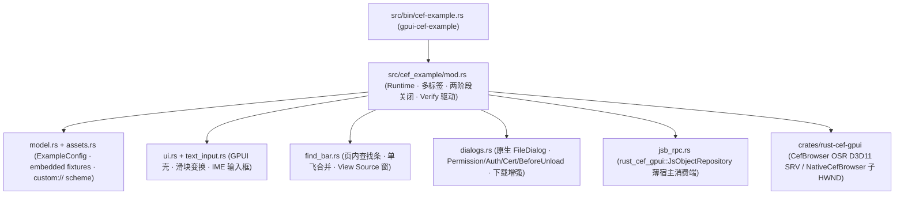

# 项目结构说明（`cef-rs-gpui` v0.2.0）

本文按当前源码整理（核对日期：**2026-11-26 / `v0.2.0`**），说明五包 `rust-cef-*` workspace、GPUI 补丁、桌面示例、辅助脚本与文档职责。更多接入指南与实证请见 [README](../README.md)、[API 参考索引](api/README.md)、[SDK 接入指南](sdk-guide.md)、[桌面示例指南](desktop-example.md)、[架构设计](architecture.md)、[组件视图接入](component-view.md)、[发行契约](component-deployment.md) 与 [验证记录](validation.md)。

---

## 1. 项目定位与核心依赖

`cef-rs-gpui`（根包 `gpui-cef-poc` `v0.2.0`，Rust edition 2024）面向 **Windows x64 MSVC** 提供嵌入式 Chromium（**CEF `156.0.31`**）组件套件与 **GPUI** 视图集成层，支持 **D3D11 共享纹理零拷贝 OSR（默认）** 与 **Win32 原生子窗口 `NativeChildHwnd`（opt-in）** 双后端；纯逻辑核心 [`crates/rust-cef-core`](../crates/rust-cef-core) 保持零外部依赖并支持在 Linux / macOS 执行纯 `std` 单测。

| 依赖项 | 版本 / 固定来源 | 用途 |
| --- | --- | --- |
| `cef` / `cef-dll-sys` | [`tauri-apps/cef-rs`](https://github.com/tauri-apps/cef-rs/tree/7b6bf84e76e919790bd61df077e29dc4132eb5e2) `156.7.0+156.0.31`（rev `7b6bf84e76e919790bd61df077e29dc4132eb5e2`） | CEF `156.0.31+ge603d97+chromium-156.0.8078.100` Rust 绑定 |
| `gpui` / `gpui_platform` | `gpui-pre =0.3.12` / `gpui-pre-platform =0.3.12`（经 `[patch.crates-io]` 指向 [`patches/gpui-pre`](../patches/gpui-pre) 与 [`patches/gpui-pre-windows`](../patches/gpui-pre-windows)） | GPUI 窗口、元素布局、DirectX 表面直绘（SRV / 旋转 / 透明度 / 采样模式 / DXGI 调优）与原生 OS 对话框 |
| `gpui-component` | `=0.9.1`（根包可选依赖，`optional = true`，仅 `legacy-demo` 启用） | 历史原型复用，默认组件与桌面示例不强依赖 |
| `windows` / `windows-core` | `0.61` | D3D11 / DXGI 共享纹理、Win32 `#32768` 菜单、IMM32 / 临时 caret、OLE 外拖与 `IDropTarget` |
| `image` / `smallvec` / `raw-window-handle` | `0.25` / `1.15` / `0.6` | 像素包装、按需 PNG 截图编解码与父窗口 `HWND` 提取 |

---

## 2. 顶层目录与辅助工程

| 路径 | 职责 |
| --- | --- |
| [`Cargo.toml`](../Cargo.toml) / `Cargo.lock` | 根包（`gpui-cef-component-demo`、`gpui-cef-example`、`legacy-demo` 可选 `gpui-cef-poc`）与五包 workspace 定义及锁定依赖 |
| [`.cargo/config.toml`](../.cargo/config.toml) | 配置默认相对 `.cef/156.0.31_windows_x86_64`、`scripts/windows-toolchain.cmake`（`/utf-8`）及 Cargo runner（[`scripts/cargo-run.ps1`](../scripts/cargo-run.ps1)） |
| [`crates/`](../crates) | 五包核心架构：`rust-cef-core`、`rust-cef-runtime`、`rust-cef-helper`、`rust-cef-ui`、`rust-cef-gpui` |
| [`patches/`](../patches) | 本地 `gpui-pre` / `gpui-pre-windows` 补丁：外部 D3D11 SRV 直绘、`Angle` / `Opacity` / 缩放采样、双缓冲 `FLIP_DISCARD`、`MaximumFrameLatency=1` 等 |
| [`src/cef_example/`](../src/cef_example) / [`src/bin/cef-example.rs`](../src/bin/cef-example.rs) | 全功能桌面浏览器示例（`gpui-cef-example`），含嵌入式测试页 `src/cef_example/test_resources/` |
| [`src/component_demo/`](../src/component_demo) / [`src/bin/component-demo.rs`](../src/bin/component-demo.rs) | 公开组件边界演示宿主（`gpui-cef-component-demo`，支持单视图、多标签壳或 `--cef-example true`） |
| [`examples/bing_cn.rs`](../examples/bing_cn.rs) | 轻量在线浏览示例（支持 OSR、`-NativeHwnd`、`-SelfTestOsr`、`-SelfTestOsrDnd`） |
| [`scripts/`](../scripts) | 构建、打包、运行（`run-example.ps1` / `run-bing.ps1` / `run.ps1`）与多阶段原生/桌面自动化验证脚本 |
| [`assets/`](../assets) | 编译时嵌入的组件离线演示页、Profile 测试页与交互探针页 |
| [`docs/`](../docs) | 项目文档（含本页、[API 参考索引](api/README.md)、SDK 接入指南、桌面示例指南、架构设计、视图接入、发行契约、验证记录与变更记录） |
| [`.github/workflows/`](../.github/workflows) | [`ci.yml`](../.github/workflows/ci.yml)（格式检查、跨平台 `core`/`ui`、Windows MSVC 单测与校验）与 [`release.yml`](../.github/workflows/release.yml)（Release 编译打包与 `.zip` + `.sha256` 发布） |
| [`openspec/`](../openspec) | 主规格（[`openspec/specs/`](../openspec/specs)）与归档/进行中的变更提案、设计及任务清单 |
| [`validation/`](../validation) | 独立验证工程：`component-host` 与 `gpui-runtime-probe`（排除出主 workspace 独立验证）；`api-check` 仅作历史类型检查留存（引用 GPUI 0.2.2，不代表当前构建） |
| `.cef/` / `.deps/` | 运行脚本自动导出的本地 CEF `156.0.31_windows_x86_64` 与辅助缓存（不入版本库） |

> **`docs/api/` API 参考分章**：[总索引](api/README.md) · [Runtime 与生命周期](api/runtime-and-lifecycle.md) · [浏览器视图与渲染表面](api/browser-views.md) · [事件与回调系统](api/events-and-callbacks.md) · [JS 桥接、对象仓储与异步操作](api/js-bridge-and-async.md) · [Handler 与可插拔宿主能力](api/handlers-and-capabilities.md) · [桌面交互服务](api/desktop-services.md) · [类型、错误与常量](api/types-and-errors.md)

> **输出产物目录**：所有 PowerShell 构建、打包与验证脚本（[`scripts/common.ps1`](../scripts/common.ps1)）默认将编译中间产物与 bundle 写入短路径 **`E:\cargo-target\gpui-cef-poc\`**（若无 `E:\cargo-target`，回退为 `<RepoDrive>:\cargo-target\cef-rs-component`），避免在仓库根生成 `target\` 触发 Windows `MAX_PATH` 限制。

---

## 3. 五包 `rust-cef-*` 模块职责

### 3.1 `crates/rust-cef-core`（零外部依赖纯 `std`）

- **进程与实例契约**：`contracts.rs`（`RuntimeConfig`、`RuntimeSettings`、`BrowserOptions`、`BrowserSurfaceMode`、`NativeChildHwndConfig`、`PixelRect`、`TrustedContentPolicy`、`ShortcutFilter`）、`ports.rs`（`BrowserCommand`、`BrowserEvent`、`EngineError`、`GpuSharedTextureFrame`、`SHARED_TEXTURE_SLOT_COUNT = 4`、`SharedTextureSlotTracker`）、`runtime.rs`、`session.rs`、`profiles.rs`、`cursor.rs`。
- **帧与预算**：`mailbox.rs`、`frame_budget.rs`（每 Browser `256 MiB` CPU 像素预算）、`frame_layout.rs`、`frame_store.rs`、`resize_recovery.rs`（`100ms` / 最多 8 次恢复策略）。
- **交互、菜单与扩展契约**：`input.rs`、`keymap.rs`、`ime.rs`、`file_drop.rs`、`inbound_drag.rs`、`outbound_drag.rs`、`accessibility.rs`、`menu.rs`、`menu_model.rs`、`menu_context.rs`、`menu_lease.rs`、`menu_requests.rs`、`find.rs`、`source_view.rs`、`print.rs`、`custom_schemes.rs`、`js_bridge.rs`（`256 KiB` / `32` 层深度边界）、`url_request.rs`、`host_capabilities.rs`。

### 3.2 `crates/rust-cef-runtime`（零 GPUI 依赖，CEF `156.0.31` 原生宿主）

- **启动、调度与部署**：`deployment.rs`、`build_stamp.rs`、`subprocess.rs`、`app.rs`、`executor.rs`、`registry.rs`、`runtime.rs`、`attachment.rs`（`BrowserAttachment` 与 `RuntimeBrowserBridge`）、`profiles.rs`、`profile_paths.rs`、`profile_flush.rs`、`profile_cookies.rs`。
- **渲染采集与原生子窗**：`capture/{mod,cpu,d3d11,timing}.rs`（4 槽 D3D11 共享纹理零拷贝输出与按需 staging 读回 `readback_shared_texture_frame`，及 `OnPaint` 软件采集）、`native_hwnd.rs`（Alloy `SetAsChild`、`WS_EX_NOACTIVATE`、`DestroyNativeChildHwnd`）、`popup_window.rs`（受管原生子弹窗）、`resize.rs`。
- **Handler 与宿主能力**：`client.rs`、`client_handlers.rs`（`DragHandler` / `FrameHandler` / `AudioHandler`）、`policy.rs`、`policy_handlers.rs`、`policy_native.rs`（含 `JsRepositorySettings`）、`resource_policy.rs`、`scheme_handlers.rs`、`before_unload.rs`、`host_requests.rs`、`pdf_export.rs`、`print_operations.rs` / `print_provider.rs`、`url_request.rs`、`headless_cdp.rs`、`devtools/`、`spelling.rs`。
- **查找、源码提取与 JS 桥接**：`find.rs`、`source_view.rs`、`host_find_source.rs`（`Runtime::find` / `stop_finding` / `view_source` / `set_find_sink` / `set_source_viewer` 与 `cutoff_sequence` 防 TOCTOU）、`frame_text.rs`（`FrameTextLedger`）、`js_bridge_native.rs`、`jsb_bridge_js.rs`、`helper_app.rs`、`menu_bridge.rs`、`win32_menu.rs`（原生 `#32768` 菜单）。
- **原生验证探针二进制**：`bin/{runtime-probe,profile-probe,profile-restart-probe,policy-probe,navigation-probe,renderer-probe,file-drop-probe}.rs`（需 `--features test-support` 启用测试支撑钩子）。

### 3.3 `crates/rust-cef-helper`、`crates/rust-cef-ui` 与 `crates/rust-cef-gpui`

- **`crates/rust-cef-helper`**：`lib.rs`、`main.rs`、`build.rs`、`app.manifest`（Windows 10/11 + `PerMonitorV2` 清单），严格拒绝无 `--type` 启动（退出码 `2`）。
- **`crates/rust-cef-ui`**（零 GPUI 依赖）：`surface.rs`、`binding.rs`、`dispatcher.rs`、`input.rs`、`file_drag.rs`、`ime_geometry.rs`、`native_slot.rs`、`outbound_drag.rs`、`find_inbox.rs`、`source_inbox.rs`。
- **`crates/rust-cef-gpui`**：
  - `view.rs`（`CefBrowser`）、`native_view.rs`（`NativeCefBrowser` 与 `recommended_windowless_frame_rate`）、`events.rs`（统一 Per-View 事件回调与控制 API）；
  - `js_repository.rs`（公开 `JsObjectRepository` SDK 与无外部依赖 RFC-8259 JSON 编解码）；
  - `async_ops.rs`（`evaluate_script_async`、`get_source_async`、`get_text_async`、`wait_for_initial_load_async`、`capture_screenshot_bgra`、`capture_screenshot_png`）；
  - `composition.rs`（`UiComposition`）、`menu.rs`、`menu_presenter.rs`、`find_view.rs`、`source_view/`、`print_confirmation.rs`、`accessibility.rs`、`native_ime.rs`、`native_keyboard/`、`native_touch.rs`、`ole_drag.rs`、`ole_drop.rs`。

---

## 4. 示例宿主架构与运行链路

| 示例模块 | 说明 |
| --- | --- |
| `src/cef_example/mod.rs` | `Runtime` 启动/关闭协调、多标签与 `Chrome Urls` 策略控制、两阶段 `BeforeUnload` 状态机、快捷键拦截与分派 |
| `src/cef_example/ui.rs` | 主界面绘制、菜单栏（`File` / `View` / `Tests` / `Chrome Urls`）、GPU 表面旋转/透明度/采样控制、`Download info` 抽屉与 `NativeHwnd` Airspace 显隐同步 |
| `src/cef_example/find_bar.rs` | 每标签查找条 UI、单飞排队合并与延后 `StopClearSelection`、IME 守卫及有界 GPUI `"Page source"` 窗口 |
| `src/cef_example/dialogs.rs` | 原生文件上传/保存对话框跟踪（`FileDialogTracker`）、交互式 Permission/Auth/Cert/BeforeUnload 弹窗及下载 `Save As` / `Cancel` / `Open Containing Folder` |
| `src/cef_example/text_input.rs` | 可复用 GPUI 文本输入框（光标、选中、双三击、剪贴板、撤销、IMM32 `EntityInputHandler` 及 `AuthPass` `•` 掩码渲染） |
| `src/cef_example/jsb_rpc.rs` | `rust_cef_gpui::JsObjectRepository` 的薄示例消费端，承载 QUnit `bound` / `boundAsync` / `boundAsync2` 夹具 |
| `src/cef_example/assets.rs` / `test_resources/` | 内嵌 20+ 测试页面、`custom://cef-rs-gpui/` 资产、`ResourceInterceptor` 与 `ResponseBodyFilter` |
| `src/cef_example/verify.rs` | `--verify-tests true` 16 阶段自动化验证驱动 |

---

## 5. `legacy-demo` 审计与维护状态

- **范围**：[`src/main.rs`](../src/main.rs) → `src/windows.rs` → `src/ui.rs` 与 `src/browser/`（`cef_app.rs`、`channel.rs`、`context_menu.rs`、`d3d11_receiver.rs`、`dnd.rs`、`mod.rs`、`ole_drag.rs`、`plan.rs`、`probe.rs`、`render_handler.rs`、`shared_texture.rs`），仅在显式启用 `--features legacy-demo` 时编入 `gpui-cef-poc` 二进制。
- **兼容性保留**：`scripts/check.ps1`、`scripts/build.ps1 -Legacy`、`scripts/test-cargo-run.ps1` 与 `scripts/test-component-workspace.ps1`（以 `--workspace --features legacy-demo` 校验全工作区与可编译性）均完整保留，不破坏既有测试/构建入口；[`src/lib.rs`](../src/lib.rs) 同时兼容导出纯核心模块供 `check.ps1` 验证。
- **状态结论**：**deprecated maintenance-only / archive-candidate** —— 该模块系早期 PoC 原型，新功能与 bugfix 均只进入 `crates/rust-cef-{core,ui,runtime,helper,gpui}`、`src/cef_example/`、`examples/bing_cn.rs` 与 `src/component_demo/`。
