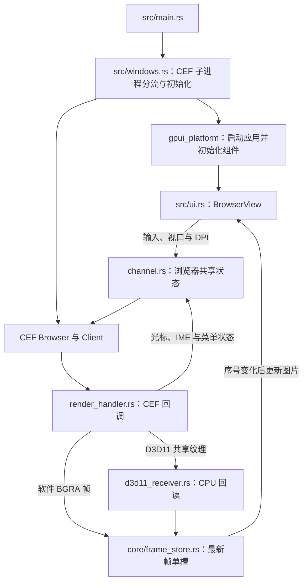

# 项目结构说明（当前实现）

本文按当前源码整理，核对日期：2026-11-21（`r461` 交付收口并归档）。描述实际五包 `rust-cef-*` 目录与模块职责；完整能力边界与验证证据见 [README](../README.md)、[组件视图接入](component-view.md)、[发行契约](component-deployment.md)、[验证记录](validation.md) 与 [实施清单](../openspec/changes/archive/2026-11-21-componentize-gpui-cef/tasks.md)。

## 项目定位与依赖

当前实现是 Windows x64 MSVC 平台的 Rust 桌面嵌入式 CEF 组件与 GPUI 适配层：GPUI 管理原生窗口与交互，CEF 以离屏渲染（OSR）运行网页，再由 UI 无关管线 `rust-cef-ui` 与薄适配层 `rust-cef-gpui` 显示网页帧；右键菜单由零 GPUI 依赖的 `rust_cef_runtime::win32_menu::Win32ContextMenuHost` 驱动原生 `#32768` 菜单。默认 HTML 编译进程序，不需要前端开发服务器，也没有独立的 Node.js 前端工程。

根 `Cargo.toml` 同时定义 PoC 示例包（默认二进制 `gpui-cef-component-demo`，可选 `legacy-demo` 特性保留 `gpui-cef-poc`）及五包 workspace：
- `crates/rust-cef-core`（纯 `std` 零外部依赖）
- `crates/rust-cef-runtime`（绑定固定 CEF 146.0.9 + Win32 原生菜单，无 GPUI 依赖）
- `crates/rust-cef-helper`（独立子进程可执行文件，嵌入 Win10/11 + `PerMonitorV2` 清单，无 GPUI 依赖）
- `crates/rust-cef-ui`（UI 框架无关的 `SurfacePipeline` / `SurfaceTarget` 与收件箱抽象，无 GPUI 依赖）
- `crates/rust-cef-gpui`（薄 GPUI 适配层：`CefBrowser`、`UiComposition`、`DefaultMenuPresenter`、Win32 IMM32/临时 caret 与原生键盘服务）

`validation/api-check`、`validation/component-host` 与 `validation/gpui-runtime-probe` 显式排除于主 workspace，各按其任务独立验证。

| 依赖 | 当前配置与用途 |
| --- | --- |
| `gpui` | 实际包名 `gpui-pre`，精确版本 `0.3.12`，提供窗口、视图、绘制和输入接口 |
| `gpui_platform` | 实际包名 `gpui-pre-platform`，精确版本 `0.3.12`，提供平台应用入口 |
| `gpui-component` | 精确版本 `0.9.1`，仅保留初始化兼容或宿主选择性使用；默认右键菜单已迁移至 Win32 原生 `#32768` |
| `cef` | `tauri-apps/cef-rs`，固定提交 `02cd5a01abb9db835549b3632cbf93ee73323e56`（绑定 CEF `146.0.9+g3ca6a87+chromium-146.0.7680.165`） |
| `windows` / `windows-core` | Win32、IMM32/临时系统 caret、OLE 拖放、D3D11 和 DXGI 接口 |
| `image` / `smallvec` | 将网页像素包装成 GPUI 可绘制的图片 |

## 顶层目录

| 路径 | 职责 |
| --- | --- |
| `Cargo.toml` / `Cargo.lock` | Rust 包定义、平台依赖、构建优化参数与依赖锁定 |
| `.cargo/config.toml` | 配置默认 CEF 缓存路径、Windows CMake 工具链和 Cargo runner |
| `src/` | 公开示例宿主 `src/component_demo/` 与仅 `--features legacy-demo` 启用的旧 PoC / 自测夹具 |
| `crates/` | 五包分层：`rust-cef-core`、`rust-cef-runtime`、`rust-cef-helper`、`rust-cef-ui`、`rust-cef-gpui` |
| `assets/` | 编译时嵌入的离线演示页和交互测试页 |
| `scripts/` | Windows 构建、运行时整理、运行及回归测试脚本 |
| `docs/` | 项目结构、架构说明、变更说明与验证记录 |
| `validation/api-check/` | 历史 API 类型检查工程，不是可发布应用 |
| `openspec/` | 主规格与变更历史；`componentize-gpui-cef` 已归档至 `openspec/changes/archive/2026-11-21-componentize-gpui-cef/`（5 份主规格已同步至 `openspec/specs/`），旧 `migrate-to-gpui-pre` 单独保留 |
| `.agents/notes/` | 已实施的架构、修复与验证笔记（原拟议方案均已转入 `implemented/`） |
| `.pi/` | 本项目的代理技能、提示模板及本地会话辅助数据，不参与应用编译 |
| `.cef/` | 本地 CEF SDK 与运行时缓存；当前版本目录为 `146.0.9_windows_x86_64` |
| `target/` | 编译、测试及 bundle 等生成产物 |
| `.idea/` | IDE 本地工程配置，不参与程序运行 |

`.deps/` 是脚本按需使用的上游工具缓存目录，不要求源码初始状态下存在。`.gitignore` 排除了 `/target/`、`/.cef/`、`/.deps/` 和 `*.log`。根目录已有的 `frame-log.txt`、`paint-log.txt` 等诊断输出不是源码模块；它们不在当前 `*.log` 忽略规则的覆盖范围内。

## 已创建的组件包

| 路径 | 当前实际职责 |
| --- | --- |
| `crates/gpui-cef-core/src/contracts.rs` | 显式配置、ID/代际、纯数据状态及错误，不执行原生部署检查 |
| `crates/gpui-cef-core/src/session.rs` | 校验profile代际，持有创建配置，接纳请求仍保持Creating |
| `crates/gpui-cef-core/src/profiles.rs` | 纯std ProfileCatalog、默认/命名ID、同名去重、就绪合并与无fallback校验 |
| `crates/gpui-cef-core/src/ports.rs` | engine/executor/event/frame/UI/菜单/策略/诊断等显式接口和自有消息，不含CEF/GPUI类型 |
| `crates/gpui-cef-core/src/runtime.rs` | 纯StartupState合并initialize返回和ContextReady两种顺序；不持原生对象 |
| `crates/gpui-cef-core/src/frame_store.rs` | 实际单槽帧存储及6原测试，仍是旧单帧上限，不是第9组总预算邮箱 |
| `crates/gpui-cef-core/src/keymap.rs` | 实际键位/修饰键/滚轮/坐标纯逻辑及8原测试 |
| `crates/gpui-cef-core/src/menu.rs` | 实际自有菜单模型、规整/加速符逻辑及4原测试 |
| `crates/gpui-cef-core/src/resize_recovery.rs` | 实际有界刷新策略及7原测试 |
| `crates/gpui-cef-runtime/src/{lib,deployment,subprocess,build_stamp}.rs`、`build.rs` | 无GPUI；清单/PE/hash/路径校验、cohort摘要与实际子进程bootstrap |
| `crates/gpui-cef-runtime/src/{runtime,app,executor,registry,client}.rs` | 显式主线程owner、双模式启动/UI异步创建、软件FrameStore和最小关闭屏障；接纳封口/引用清理/continuation排空已有G1验证，真实menu/JS callbacks仍在后续 |
| `crates/gpui-cef-runtime/src/bin/runtime-probe.rs` | test-support独立进程探针，观测线程/fixture BGRA/创建关闭，不创建GPUI |
| `crates/gpui-cef-runtime/src/profiles.rs` | 真实global/独立Memory context持有表、handler就绪标记、异步身份比较及shutdown前引用退场 |
| `crates/gpui-cef-runtime/src/{profile_fixture,bin/profile-probe}.rs`、`assets/profile-test.html` | test-support同源HTTP夹具与真实cookie/localStorage共享隔离、软件帧/正常关闭验证 |
| `scripts/{test-component-profiles,component-probe-launcher}.ps1` | Profiles双模式驱动，复用原子握手/OS镜像/退出观察，不以配置代替观测 |
| `crates/gpui-cef-component/src/{lib,dispatcher}.rs` | 契约和capacity1线程安全UI唤醒，CefBrowser产品视图仍待接入 |
| `validation/gpui-runtime-probe/` | 只公开依赖的最小真实GPUI宿主，前台协程持Runtime、pump在App借用外，双模式验证通知和关闭 |
| `crates/gpui-cef-helper/src/{lib,main}.rs` | 真实独立helper，非空type才调用CEF分流；无type拒绝2，不创建Application/Browser |
| `crates/*/scripts/cargo-run.ps1` | 成员测试cwd下转发到原root runner，保持argv和退出码，不增加新启动器依赖 |

2.3迁移时core为25原逻辑+7契约=32测试；当时workspace为67，原菜单4用例不再在bin重复编译，并新增1类型/行为兼容用例。check.ps1直接编译真实core rlib后运行46项纯逻辑/离线检查，不构建GUI。3.2最终workspace92普通用例+额外harness=false真实部署通过；core与standalone计数未变。新增close-intent契约后core实际33，standalone仍46；runtime test-support全目标39通过，随后最小Native双模式软件各1帧320×240/正常关闭。此结果不是完整G1或组件验收，详情见validation.md。当前新增Memory profile后core46、standalone纯rustc60、workspace211普通用例+真实部署通过；Native+GPUI完整G1回归16项及两模式Profiles（各16次存储检查/5次身份检查）均通过，但完整G2仍须第7组路径与持久重启。

## Rust 源码职责

### 应用入口和视图

| 文件 | 职责 |
| --- | --- |
| `src/main.rs` | Windows 下调用 `windows::run()` 并返回退出码；非 Windows 下提示平台限制并退出 |
| `src/lib.rs` | 兼容导出实际core模块，保留plan/shared_texture及内嵌HTML/data URL；有类型/行为兼容测试 |
| `src/windows.rs` | CEF 子进程分流、初始化、浏览器创建、GPUI 启动、消息泵、多实例、自测调度和关闭清理 |
| `src/ui.rs` | `BrowserView`：网页帧显示、旧图片资源释放、视口和 DPI 同步、鼠标键盘与 IME 转发、文件拖入、光标与右键菜单 |

### CEF 桥接模块

`src/browser/mod.rs` 声明模块并集中导出应用使用的类型；部分纯逻辑通过 `gpui_cef_poc` 库复用，而不是在桌面入口中重复声明。

| 文件 | 职责 |
| --- | --- |
| `src/browser/cef_app.rs` | 构建 CEF App 回调，设置启动窗口和日志相关命令行开关 |
| `src/browser/channel.rs` | GPUI 与 CEF 回调共享的浏览器状态，包括 Browser/Host、视口、缩放、光标、标题、IME 和菜单状态 |
| `src/browser/render_handler.rs` | CEF 客户端及相关回调：视口与屏幕信息、软件/加速绘制、光标、IME、菜单、拖拽和关闭通知 |
| `src/browser/d3d11_receiver.rs` | 打开 CEF 的 D3D11 共享纹理，通过 staging 纹理回读像素 |
| `src/browser/shared_texture.rs` | 加速帧的格式、行距和像素通道处理等纯逻辑 |
| `src/browser/context_menu.rs` | 仅兼容转发实际 `rust_cef_core::menu`（供 `legacy-demo` UI 渲染） |
| `src/browser/dnd.rs` | GPUI 与 CEF 之间的拖放事件、数据及操作掩码转换 |
| `src/browser/ole_drag.rs` | 网页向外拖拽所需的 OLE `IDataObject`、`IDropSource` 和系统拖放循环；属于受开关控制的试验路径 |
| `src/browser/plan.rs` | 自测步骤定义与通过/失败判定规则 |
| `src/browser/probe.rs` | 将自测步骤发送到 GPUI 处理器或 CEF BrowserHost |

src/lib.rs通过pub use导出core的frame_store/keymap/resize_recovery及menu as context_menu；只有演示plan/shared_texture仍以path模块加载。四份迁入core的实际源码与25原测试逐字节保留，契约测试在crates/gpui-cef-core/tests/contracts.rs；根库兼容测试验证旧导出与core同一名义类型及实际行为。

## 运行链路

当前将 CEF UI 操作安排在 GPUI 主线程。独立 ticker 线程每约 8 ms 设置一次待处理标记，前台任务检查标记并调用 `do_message_loop_work()`；ticker 本身不直接调用 CEF，也尚无显式停止令牌。窗口关闭后，当前代码继续驱动 CEF，但只显式关闭并等待主 Browser，额外实例未纳入同一关闭等待；Channel 内 Browser 强引用也没有统一清空协议。不能据此认为多实例关闭和全部引用释放已经完成，目标修正见架构草案。

当前默认尝试启用加速 OSR；`POC_ACCELERATED=0` 可切换软件路径，D3D11 接收器创建失败时也会使用软件路径。加速路径仍经过 CPU 回读与 GPUI 图片上传，不是 GPU 零拷贝。视口随界面尺寸与 DPI 更新，1024×640 只是默认初始值，不是固定网页尺寸。

多实例模式由 `POC_BROWSERS` 控制，每个浏览器保持独立的 Client、FrameStore、BrowserChannel 和视图，避免回调状态串用。

## 页面资源

| 文件 | 用途 |
| --- | --- |
| `assets/demo.html` | 默认离线演示页 |
| `assets/interaction-test.html` | 统一交互探针页，通过页面标题等方式报告收到的输入与拖放事件 |

页面通过 `src/lib.rs` 编码为 data URL，不依赖运行目录中的 HTML 文件。只有显式 `-Legacy` 路径可用 `START_URL` 覆盖初始页面；默认组件示例只加载自带离线页。两条路径都只适用于可信内容。

## 构建与验证脚本

| 文件 | 用途 |
| --- | --- |
| `scripts/common.ps1` | 共用工具检查、MSVC 环境导入、CEF 路径解析、运行时校验及复制、构建目录处理 |
| `scripts/windows-toolchain.cmake` | Windows 原生依赖编译的 UTF-8 编码选项 |
| `scripts/cargo-run.ps1` | 组件 runner 启动显式 bundle 中与 Cargo 产物字节一致的宿主；旧 PoC 和根测试继续原 DLL staging，保持 argv 和退出码 |
| `scripts/build.ps1` | 默认构建公开组件宿主和独立 helper 并生成新发行目录；`-Legacy` 保留旧 bundle，不下载 CEF 或启动 |
| `scripts/package-component.ps1` | 显式host/helper/SDK/输出/host版本，保护源SDK物理目录树，复制发行材料并生成schema1清单 |
| `scripts/run.ps1` | 获取匹配的 CEF、构建、整理 bundle 并运行，也支持 smoke 等模式 |
| `scripts/check.ps1` | 格式与核心／根库测试；原 Smoke、交互、IME 和拖放选项仍显示或断言旧 PoC 行为 |
| `scripts/test-cargo-run.ps1` | 显式 legacy 启动和原首帧／shutdown 回归；不是组件 runner 的实跑入口 |
| `scripts/test-cargo-runner.rs` | 独立验证 runner 的参数转义与退出码透传 |
| `scripts/os-input-test.py` | 通过 Win32 SendInput 检查真实操作系统输入链路 |
| `scripts/context-menu-test.py` | 真实窗口中重复打开右键菜单的回归检查 |
| `scripts/resize-test.py` | 失焦持续出帧与逐步 resize 跟随检查 |
| `scripts/drag-quality-test.py` | 检查 resize 期间是否按网页帧自身尺寸绘制，避免重采样失真 |
| `scripts/shrink-grow-test.py` | 极小窗口恢复为大窗口后的帧与显示恢复检查 |
| `scripts/html5-drag-test.py` | 使用真实系统输入检查页内 HTML5 拖拽试验路径 |

`cargo build --locked` 只构建默认组件宿主。`scripts/build.ps1` 默认往 `target/component-bundles/<运行ID>/` 部署一组明确配套材料，`scripts/run.ps1` 给真实宿主传入显式路径。实际 `cargo run --locked` 也需要 `--bundle` 等 CLI，runner 对账但不在 Cargo 目标目录自行生成发行资源。`target/bundle-debug`／`bundle-release` 为 `-Legacy` 保留，不用于默认组件。

Python 实机测试依赖 Windows 交互桌面，不等价于纯逻辑单测。网页向外拖拽默认关闭，`POC_DRAG_OUT=1` 仅供试验，不应因脚本存在就视为该能力已稳定可用。

## 文档与辅助工程

| 路径 | 内容及阅读边界 |
| --- | --- |
| `README.md` | 项目入口、环境准备、运行方式与已知限制 |
| `docs/project-structure.md` | 当前目录、模块职责和主要运行链路，即本文 |
| `docs/architecture.md` | GPUI-CEF-COMPONENT 目标架构探索草案；区分现有证据、拟议接口和待确认项，不是已实施架构 |
| `docs/changes.md` | 相比初始工程的修复说明 |
| `docs/validation.md` | 分阶段验证记录；阅读时应结合记录日期和后续补充，不应把历史结果当作本轮验证 |
| `.agents/notes/implemented/bug-fix/` | 菜单生命周期、Cargo 启动、OSR resize 恢复等修复决策笔记 |
| `openspec/changes/migrate-to-gpui-pre/` | GPUI 迁移的 proposal、design、tasks 及相关规格材料 |
| `validation/api-check/` | 早期不链接 CEF 的类型检查用途；其清单仍引用 GPUI 0.2.2，与根包版本不同，不能替代当前 Windows 构建和实机验证 |

默认入口从 `src/bin/component-demo.rs` 读到 `src/component_demo/{cli,host}.rs`。原 PoC 的 `src/main.rs` → `src/windows.rs` → `src/ui.rs` 和 `src/browser/` 只由 `legacy-demo` 入口使用，保留旧验证和恢复路径。纯逻辑问题可从 `src/lib.rs` 暴露的模块入手；构建与运行时问题则从 `.cargo/config.toml`、`scripts/cargo-run.ps1` 和 `scripts/common.ps1` 入手。
