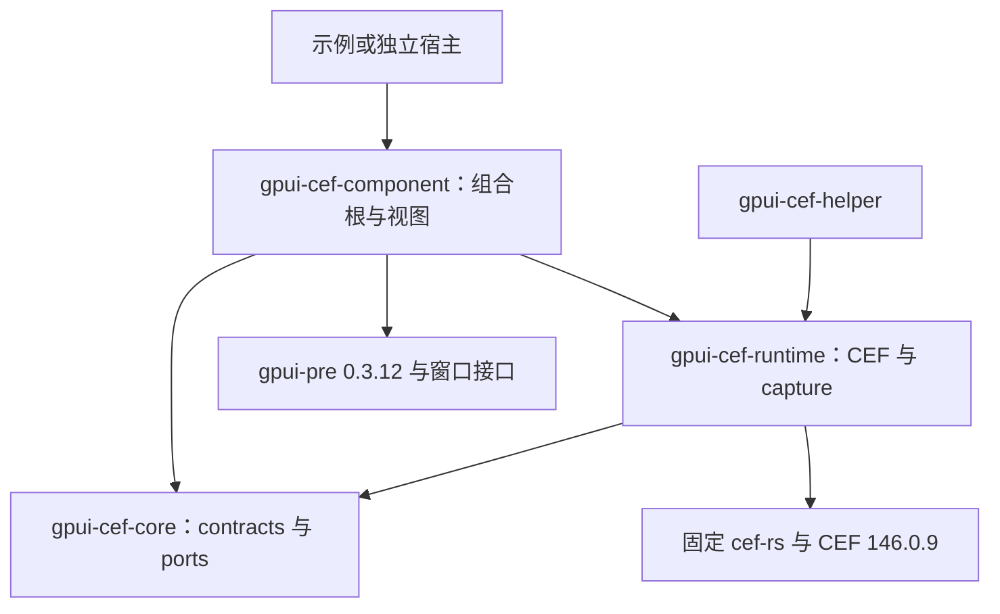
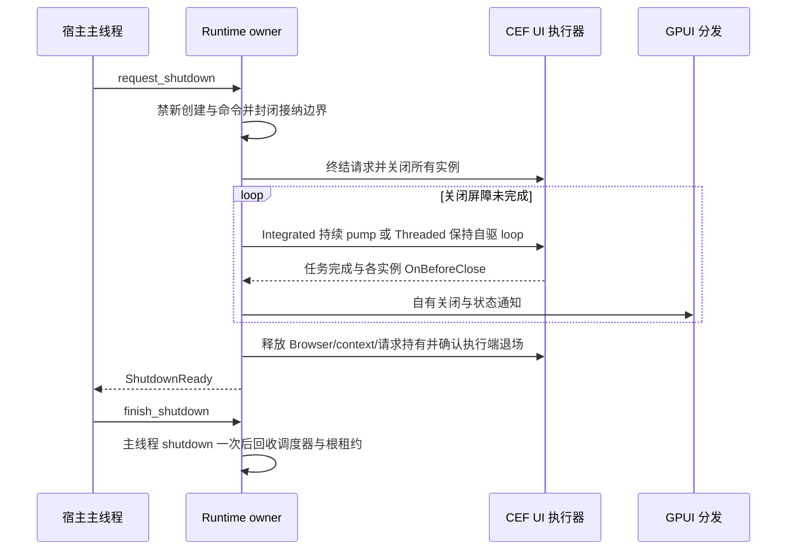

# Design

## Context

动机与范围见 [proposal.md](proposal.md)，行为契约见本变更五份 [specs](specs/cef-runtime-host/spec.md)。用户已确认 Windows x64 可信内容、独立 helper、两种线程模式分别验收、基础完整网页交互、默认共享与可选独立 profile，以及内存/持久化两种存储。原整体设计仍须实施与证据核验；Round32菜单兼容/宿主管理修订已获用户逐项批准，不代表其新API或原生能力已经实现，也不将未确认的其他细节默认视为已拍板。

当前 `src/windows.rs` 是进程、窗口、同步创建、pump 和退出的混合入口；`src/ui.rs` 直接使用 BrowserHost；额外 Browser 没有统一关闭等待；ticker 没有停止协议。菜单 ID/锁外响应、完整自有 BGRA、1:1 绘制和限频 resize 恢复是必须保留的已验证经验。历史全量测试还有旧 API 编译失败，先恢复基线，不能删测掩盖。

参考依据为 [CefSharp.Wpf 笔记](../../../.agents/notes/implemented/architecture/2026-11-11-cefsharp-wpf-reference.md)，不是照搬其静态 Cef、全局退出钩子或 WPF 位图。固定 CEF SDK/cef-rs 已核实支持两种 loop 与 RequestContext，仍须最小 Windows 探针证明它们与 GPUI/helper 的实际组合。

## Goals / Non-Goals

Goals：让未接触本 PoC 的宿主只通过公开接口获得可嵌入视图；让两种线程模式遵循同一实例/事件/帧契约；由 Runtime 收口原生引用、profile 与终止；每个阶段都有可执行验收和停止条件。

Non-Goals：同进程两个 Runtime、运行时切换线程模式、同进程 shutdown 后重新 initialize、View 跨窗口迁移、未挂载页面预热 API、外部已初始化 CEF 附着、GPU 零拷贝、上游 CEF 升级，以及 proposal 明确排除的产品功能。Round32仅把固定CefSharp.Wpf菜单对应能力及其受管辅助操作纳入未完成任务，不扩成通用DevTools产品或任意外部程序启动器；DevTools菜单入口默认仍关闭。暂不公开裸 CEF 对象逃生口。

## Decisions

### 1. 交付结构与文件归属

选择四个职责独立的内部包而非把所有代码继续放在根应用或立即拆成许多插件：纯核心可跨平台测试，Runtime/helper 无 GPUI 依赖，公开组件包装保持简洁。内部包是否单独发布 crates.io 不在首版要求中；先提供可复现的源码 workspace 和发行目录。

| 包/路径（计划新增） | 职责与依赖 |
| --- | --- |
| `crates/gpui-cef-core/Cargo.toml`、`src/lib.rs` | 纯 std 契约与状态机；不依赖 CEF、GPUI、Win32 |
| `crates/gpui-cef-core/src/contracts.rs`、`ports.rs` | ID/代际、配置、输入/事件、错误、端口定义 |
| `crates/gpui-cef-core/src/{runtime,session,profiles,mailbox,resize_recovery,keymap,menu}.rs` | 关闭/实例/profile 状态机、有界数据通路与可测纯函数 |
| `crates/gpui-cef-runtime/Cargo.toml`、`src/lib.rs` | 私有 CEF 适配与公开给组合根的 Runtime 接线；依赖 core、固定 cef-rs、必要 Windows 接口，不依赖 GPUI |
| `crates/gpui-cef-runtime/src/{app,runtime,executor,registry,profiles,client,policy}.rs` | App/进程回调、主线程 owner、双模式执行器、原生 Browser/请求/context 注册表 |
| `crates/gpui-cef-runtime/src/capture/{mod,cpu,d3d11}.rs` | 软件与加速回调期完整帧接收；D3D context 留在 CEF UI 序列 |
| `crates/gpui-cef-component/Cargo.toml`、`src/{lib,view,input,composition,menu,platform_windows,dispatcher}.rs` | 公开 `CefBrowser`、组合根、GPUI/Win32 窗口适配；依赖 core/runtime 和唯一 GPUI 基线 |
| `crates/gpui-cef-helper/Cargo.toml`、`src/main.rs` | 独立 `gpui-cef-helper.exe`，仅依赖 runtime 的进程入口支持，不能引入 GPUI 启动 |
| 根 `Cargo.toml`、`src/main.rs`、`src/windows.rs`、`src/ui.rs` | 根包保留为 `gpui-cef-poc` 示例，转成公开组件消费者，保留现有启动命令；旧混合逻辑迁移后删除其重复实现 |
| `tests`目录（各包下）、`validation/gpui-runtime-probe/` | core状态测试、runtime原生探针；G1额外最小GPUI宿主验证公开Runtime/dispatcher关闭接线，不提前实现完整CefBrowser；G4另有独立组件宿主 |
| `scripts/{package-component,test-component,test-component-ui}.ps1` | 显式打包与分层验收；`scripts/component-*.py` 为真实窗口/profile/故障测试 |

产品显示名保留 GPUI-CEF-COMPONENT，公开 Cargo 包拟为 `gpui-cef-component`，Rust 导入为 `gpui_cef_component`。这是正常 Rust 命名映射而非改产品名称。现有 assets 与自测 plan/probe 只留示例/测试层；旧 `validation/api-check` 标历史，不扩大为新平台承诺。

运行时回报走 core 定义的显式接口，不构成 Runtime 到 Component 的反向依赖。core 不反向导入组合根；helper 不能依赖组件视图；CI 用 `cargo tree`/manifest 检查此 DAG。默认菜单初期沿用 gpui-component 0.9.1，初始化由公开、幂等的 GPUI 接入函数显式完成，不在 View 构造中私建 Application；对宿主已有组件初始化的兼容须在最小宿主测试验证。无替换需求前不额外发明 FramePresenter 插件系统。

### 2. 内部接口与公共契约

以下为本项目拟实现的签名/数据约定，不是声称上游提供这些 API。所有公共 ID 带 Runtime 代际；typed handle 不包含宿主可操作的 native 指针。

| 接口（所有者） | 拟议签名/数据与语义 |
| --- | --- |
| `RuntimeConfig` | 必填 `thread_mode: ThreadMode`、`files: RuntimeFiles`、`root_cache_path: PathBuf`、`default_profile: ProfileStorage`、`content_policy: TrustedContentPolicy`；无隐式模式和存储默认 |
| `ThreadMode` | `Integrated` / `Threaded`；仅进程级启动选择，不是 Browser 属性 |
| `Runtime::start`（runtime） | `start(config: RuntimeConfig, services: RuntimeServices) -> Result<Runtime, StartError>`；主线程返回 Starting/已接纳 owner，ContextReady 另发事件；返回 false 对应 `ProcessExitRequired`，调用者必须结束进程 |
| `Runtime::create_profile` | 已落地 `create_profile(config: ProfileConfig) -> Result<ProfileRegistration, ProfileCreateError>`；registration含handle和is_new，同名复用不重建；显式profile与默认Memory都等自身handler，默认Persistent取global后就绪；稳定名称用于去重，不拼接路径 |
| `ProfileStorage` | `Memory` / `Persistent { directory: PathBuf }`；默认持久 profile 目录按 CEF global 规则映射根路径，显式 profile 用独立子目录 |
| `BrowserConfig` | 必填初始 URL/渲染偏好/初始视口，`profile: Option<ProfileHandle>`；None 固定默认共享；创建时冻结 |
| `Runtime::create_browser` | `create_browser(config: BrowserConfig) -> Result<BrowserHandle, CreateError>`；Runtime/Profile 未就绪则返回 NotReady，不暗藏无限等待队列 |
| `BrowserHandle`（core 契约） | `submit(command: BrowserCommand) -> Result<CommandId, CommandError>`、`snapshot() -> BrowserSnapshot`、`request_close(mode: CloseMode) -> CloseTicket`；仅提交自有数据，线程安全 handle 与 !Send 原生 owner 分离 |
| `BrowserEngine` / `CefUiExecutor`（ports） | `execute(envelope: CommandEnvelope) -> Result<(), EngineError>` / `post(task: OwnedEngineTask) -> Result<TaskId, PostError>`；任务描述不捕获 GPUI App/Window/Entity/Rc/RefCell |
| `BrowserEventSink` | `publish(event: BrowserEventEnvelope) -> PublishResult`；普通事件可重同步，终态有独立保留槽；事件消费者在GPUI安全分发阶段调用；`BeforeUnloadRequested { request_id, is_reload }`由宿主以`ResolveBeforeUnload { request_id, allow }`命令回答 |
| `FrameSink` / `FrameSource` | Runtime每Browser持同一FrameMailbox，`frame_source(BrowserId)`给只读端点；`latest(surface)`查询不ack，`take_update()`同锁取得两表面并重置待处理wake，`snapshot()`重同步；FrameSink保留owned观测，不控制最新槽/唤醒；像素为只读Arc<BudgetedPixels>，含完整实例/表面代际与非零单调序号 |
| `NativeViewServices` / `UiDispatcher` | 持窗口绑定令牌，投递自有 IME/菜单/更新数据，GPUI 线程执行并校验窗口仍有效，不传 HWND 给 CEF worker 持久使用 |
| `Runtime::request_shutdown` / `poll_shutdown` | `request_shutdown(mode: CloseMode, deadline: Instant) -> ShutdownTicket` / `poll_shutdown(ticket: &ShutdownTicket) -> ShutdownStatus`；不阻塞主线程，屏障完成后由 owner 的主线程 `finish_shutdown() -> Result<(), ShutdownError>` 执行一次 shutdown |

公开构造固定为 `CefBrowser::new(attachment: BrowserAttachment, window: &mut gpui::Window, cx: &mut gpui::App) -> Result<gpui::Entity<CefBrowser>, ViewError>`。用户选择一次性attachment：宿主先用 `Runtime::attach_browser(&BrowserHandle)` 在原registry完整BrowserId/排水/生命周期同锁登记一次，获得原权威FrameSource和同一handle。固定GPUI只有infallible `cx.new`，因此fallible检查在Entity工厂进入该闭包前完成，不逼宿主panic或创建假placeholder。组件不新建Application/window/Runtime、不quit/exit；所属GPUI窗口ID固定，异窗consume先拒绝、不消费Source。

登记是trusted-host接线约束，不是control对象认证；公开BrowserControl可以伪造相同BrowserId，宿主须传本Runtime实际create_browser返回的handle。token非Clone，未用或View释放都只请求原handle的Graceful，登记永不回收；Runtime保活原生关闭状态，不提供解绑后迁移/预热保活能力。宿主持有的控制句柄仍可查看关闭或显式强制，句柄Drop本身不是关闭完成证明。组合根只保留一个dispatcher foreground消费者，再向各View分发consume；take_update重新布防，RenderImage呈现副本仍计入原Browser预算，旧图保持1:1裁剪直到新转换成功。实现与首项真实接入边界见[公开View决定](../../../.agents/notes/implemented/architecture/2026-11-13-public-cef-browser-attachment.md)；10.1的单窗呈现不代替10.2完整分发/释放及10.3 POPUP与迟到通知矩阵。

公开分发采用用户确认的 `UiComposition::new(NonZeroUsize)`：容量由宿主指定，路由保存完整 BrowserId、WeakEntity、真实 AnyWindowHandle 与共享 WindowToken，组合根唯一 wake consumer 在 App update 中显式 dispatch，不能嵌套借用同一 window 后误判访问失败。每次最多尝试一遍；Access/View 错误逐实例报告，暂时窗口不可访问保留 pending，宿主在后继 UI 回合显式 retry_pending。确认 weak Entity 释放或令牌退役才移除，成功消费 Source.closed 只移除正常终态；unregister 不关闭 View 或改变一次性附件，不提供窗口迁移。

WindowToken 使用完整 WindowBinding 和 UI 线程 Rc 共享活性、checked revision；图像变化使旧 stamp 失效，溢出返回错误并永久退役，prepaint/paint 在命令及 atlas 导入前重核资格。View 保存有限的 observe_release/window_closed 及 activation 三个订阅；前两者独立控制退役，activation取消本地点击候选，不依赖可能在路由失败时跳过的 observe_release_in。替换/显式清除在真实 drop_image 成功后提交 owner、元数据和计数，失败保留好图；take_update 后转换失败留下 pending_resync，显式后继 consume 在没有新 update 时只读一次当前 snapshot 并重核关闭/隐藏/身份/代际。Entity release 先退役，再经一次 App.defer 在原窗口清理 owned image，不开任务或循环；固定 GPUI 0.3.12 effects flush 归还窗口后才执行，drop_image 当前恒 Ok。窗口销毁是不同的 atlas 退场边界，隐式清理不计入已销毁 Entity 的 released_images，不承诺消失后诊断订阅。取舍、四新进程六阶段实际窗口证据及固定版本清理边界见[分发决定](../../../.agents/notes/implemented/architecture/2026-11-13-gpui-dispatch-image-retirement.md)。

### 3. 双模式执行器与创建管线

共同入口在宿主主线程完成预检、api_hash、initialize，并预先准备可并发接收的 ContextReady 端点，防止 Threaded 的 OnContextInitialized 在 start 返回前到达。先记录启动中，再合并 callback/返回结果，原生 false 后封死所有进一步 CEF 操作。

| 阶段 | Integrated | Threaded |
| --- | --- | --- |
| init / final shutdown | 应用主线程 | 应用主线程，不是 CEF UI |
| CEF UI | 应用/GPUI 主线程 | CEF 自有 UI 线程 |
| 调度 | 保留可停止 ticker/主线程定时检查作为最小基线；执行 do_message_loop_work 时无 GPUI 借用 | CEF 自驱 loop，绝不调用手动 pump，也不启动 pump ticker |
| Browser/profile/命令 | 同一 `CefUiExecutor` 路由，禁止回调重入宿主 | `post_task(ThreadId::UI, ...)`，检查接受/失败 |
| 帧与状态消费 | 回调只发布自有数据，pump 返回后再更新 GPUI | 回调发布自有数据并唤醒 GPUI；IME/状态消费不能依赖 pump 存在 |
| 终止 | 持续主线程 pump/非阻塞检查 | 保持 CEF loop 和 UI 分发，主线程非阻塞检查 |

统一路由是本项目的顺序/生命周期设计，不是声称每个 BrowserHost 方法都被 CEF 强制限制 UI 线程。本地 cef_browser.h 指出 Host 方法默认可由 browser-process 任意线程调用，具体条目另有限制；CreateBrowserSync 则明确仅 CEF UI。两模式统一使用异步 `browser_host_create_browser`，以 `OnAfterCreated` 完成实例登记，不维护同步创建第二路径。

命令通路初始容量 256，普通事件 256；容量是规划起始值，性能阶段可调但不得移除有界/关闭保留语义。按钮/键盘/IME/请求响应不可丢弃；主线程 UI 输入遇背压时先本地处理一次排队机会，仍失败则显式报告输入拒绝并取消受影响输入手势，不假装已送达。连续 pointer move/viewport 可在不跨离散输入边界时合并。关闭走独立一次标记与请求表，不能被普通队列堵住。

Round13用户确认11.1采用每Browser独立合并单槽输入清理，普通容量保持256。拒绝UP/失焦/关闭建立清理cutpoint，此前接纳项仍执行，实际UI在途全部退场后按真实已执行pressed/composition做释放、取消、失焦，再推进新输入资格；post拒绝/UI停止只暴露未完成并拒新输入，不虚构清理成功或靠无限重试。清理计入pending/seal，native close必须在该屏障之后，beforeunload取消也不恢复旧按住。组件最多1条受限owned待发事件，宿主后继UI回合显式重试一次，期间不得越序；仍失败则拒绝并请求清理，不在GPUI借用中pump或直接调CEF。具体合同和证据门见[有序输入清理提案](../../../.agents/notes/implemented/architecture/2026-11-14-ordered-input-reset-lane.md)，实际实现与限定ASCII四格证据见task-11.1-report.md；中文组合/caret及G3/G4不由此替代。

CEF UI 单序列每次最多处理64个已接纳命令后让出；当前保留每Task一命令（1≤64），不加第二worker队列。每Session以完整BrowserId及单调sequence登记最多256个未消费命令，registry同锁覆盖接纳与异步post返回，post失败撤销；Closing拒绝新命令但不抹去关闭切点前已接纳项，关闭屏障继续等待Executor任务退场。锁内取单次owned令牌、锁外执行实际BrowserEngine，registry以完整身份为key。post_task 失败可在源线程析构任务，因此 task payload 不持依赖目标线程析构的资源；原生持有表必须通过受控退场管理，不靠 task Drop。

### 4. helper 与发行布局

helper 使用自身 `Args::new()`、api_hash 和 execute_process，把真实返回值交给入口退出；未知/非子进程启动返回诊断且非零，不启动 GPUI、Browser 或 initialize。host/helper 共用仅含所需 App 配置的进程支持代码；初版不新增自定义 scheme/JS binding，不能假定宿主 App 实例自动进入 helper。

第一版保证一个发行根目录：宿主 exe、gpui-cef-helper.exe、CEF DLL/pak/dat 和 locales 位于文档指定的相对位置（两 exe 同目录，locales 为子目录）。RuntimeFiles 由宿主传绝对路径，helper 为空/相对/不存在时预检拒绝。不同工作目录、中文/空格目录必须通过；分散到多个 DLL 搜索目录的布局不在首版保证中，明确拒绝未经验证的布局，不靠修改系统 PATH 解决。

`package-component.ps1`显式接收HostExecutable、HelperExecutable、CefPath、OutputDirectory与HostBuildVersion，不靠exe名或PE ProductVersion猜宿主构建身份。发行根固定component-runtime.json、UTF-8/schema1：target/cef_version/binding_revision/component_version，host/helper各有file_name/build_version/sha256，runtime列相对path/sha256。预检验证同目录、PE机器类型、必要文件、路径不逃逸与实际字节hash；helper另有cohort build stamp。验证器编入stamp摘要而非完整helper字串，避免普通host链接验证器后也被误认helper。此格式及取舍见 [部署笔记](../../../.agents/notes/implemented/architecture/2026-11-11-component-runtime-deployment.md)，不提供签名真伪保证。

Windows bootstrap的CEF版本查询以实际SDK cef_version_info.h及DLL导出为证据，固定Rust绑定未生成此函数，故在private adapter精确声明C int(int)并验证已加载146/0/9，再做api_hash/execute_process；不虚构cef::version_info包装或升级绑定。main前DLL失败由外部部署/冷启动覆盖，不能只靠RuntimeFiles Result。

### 5. profile 与持久化

Runtime持有按storage选择的默认共享context和ProfileId到RequestContext表。用户确认的固定CEF存储修正见[存储契约决定](../../../.agents/notes/implemented/architecture/2026-11-12-cef-storage-contract.md)：默认Memory必须独立创建空cache_path的共享incognito context，None/显式default均复用它；默认Persistent才使用global。在CEF进程ContextReady后发起默认Memory创建，Runtime Ready还须等它自身factory返回和handler标记；Persistent取得global即默认Ready，不等待不可注入的handler。

default_profile_handle/profile_state/profile_config及异步compare_profiles票据只暴露自有数据；ticket弱注册引用、poll返回布尔/错误、Drop回收结果。独立profile同样使用request_context_create_context，禁止create_context_shared。所有非global handler回调只投递ProfileInitialized UI标记，回调返回后再与create结果合并，不把非空工厂返回当Ready；端点先于调用准备，合并任意先后顺序且失败不复活。

一个Runtime固定一个非空绝对root_cache_path。Settings.cache_path在默认Memory时仍为空，但固定CEF Chrome实现会覆盖global路径，故不能把这个global用于Memory页面，必须选独立incognito。默认Persistent.directory须等于真实Runtime root，Settings.cache_path=root，由CEF的global Default规则定位。显式Persistent.directory只能是root独立直接子目录；固定CEF对孙目录会错误后退回OTR，所以显式拒绝root/profiles/P1等嵌套布局。保留root自身及Default/System Profile/Guest Profile范围，拒绝重叠、大小写/真实路径/重解析别名。缺失目录先规范化已有祖先再创建和复核，拒绝穿越reparse；所有Memory context空cache_path且不分配持久profile目录。不迁移或删除原目录，不换SDK或随机换root。

根目录由 Windows share-mode 独占文件句柄租约保护（应用层 root lease），Runtime 活跃期间持有，OS 回收句柄解除占用；不以 PID 临时换根绕过冲突。CEF 自身 singleton/relaunch 仍须按 false/exit 契约处理。不同宿主并发要使用不同 root 或明确单实例策略。

持久化验收仅承诺持久 cookie 与 localStorage 跨正常退出；session cookie 默认不持久，未来确有需求再显式开放设置。Cookie flush 回调只证明 cookie store 完成，不替代所有 storage 写回。profile 最后一个 Browser 关闭后仍留 Runtime 表以供复用；首版不提供 live profile 删除或清空 API，最终关闭后释放 context/handler，不删除持久目录。不同 context 的 renderer 分配由 CEF 契约管理，本组件承诺的是存储边界而非独立 Runtime/完整进程或安全隔离，禁用 single-process。

### 6. 渲染、输入与 UI 服务

FrameCapture 在回调作用域复制完整 BGRA；D3D11 打开/CopyResource/Map/Unmap 都在 CEF UI 串行完成，再发布自有像素。不把共享句柄或 mapped 借用数据排队给 GPUI。receiver 在对应 CEF UI 初始化/销毁，首版不将 Map 拆到另一 worker；同一 immediate context 的串行所有权比现有分段 Mutex 更重要。

实际实现以回调期 BgraInput/AcceleratedInput 共用计费 FrameCapture builder，CaptureFrameSink先提交权威mailbox再锁外观测。加速input与UI checkout为!Send/!Sync；取出GPU期间native_live/in_flight持续阻断关闭屏障，驱动操作不持endpoint/registry/预算锁，重入Busy在checkout结束后由单一when_idle通知post tracked RetireCapture(BrowserId) UI任务继续。每次OpenSharedResource1临时导入在回调内释放，不CloseHandle借用句柄，不引入SDK未提供的keyed mutex；实际descriptor与coded/format/mip/array/sample匹配，MapGuard覆盖成功Map后的每条退出。visible==content是保守完整帧门而非SDK总保证；crop/row-pitch/RGBA交换直接写预算输出，无额外packed Vec。Required设备/格式错误有分类和原始HRESULT，不默默回退/重建设备；GPU staging逻辑容量/瞬时峰值与CPU预算分别记，非VRAM测量。详见[捕获决定](../../../.agents/notes/implemented/architecture/2026-11-13-frame-capture-ui-owned.md)；9.2四Native Smoke不替代9.3/G3/G4完整矩阵。

每 Browser 两个表面槽 VIEW/POPUP、独立 surface generation。每槽只保留最新完整帧，UI 只为最新帧创建 RenderImage；旧图通过 GPUI 释放。初始每 Browser CPU 自有像素容量预算 256 MiB，覆盖两个mailbox槽、所有在途像素、组件自产呈现副本和scratch；不是单帧检查、Runtime全局限额或进程RSS。Box像素与租约同寿命，最后像素引用析构完字节才退额度；分配前预留，超预算拒帧并报告、保留最后好图，不承诺任意占满预算的尺寸仍能持续复制。GPUI独占Vec经可信适配器按原容量移动进入实际RenderImage，ledger保留强owner，锁外try_unwrap并真实析构后退费，不能以Weak计数0提前退费；适配器不得将Vec外逸/放进错误，非任意宿主堆限额。GPU staging另记峰值，UI atlas记录创建/释放平衡。像素premultiplied BGRA、row pitch、可见区域/内容区域和alpha必须验证。详细所有权/代际与唤醒合同及限定证据见[帧mailbox决定](../../../.agents/notes/implemented/architecture/2026-11-13-frame-mailbox-budget.md)；该实现不提前证明9.2及之后的原生双后端/GPUI矩阵。

10.3 同一FrameUpdate独立消费双表面，VIEW无新帧不得漏POPUP；双ImageSlot沿原预算/事务创建替换清理，单canvas先VIEW后原始CEF DIP位置POPUP，实际像素除所属窗口scale作1:1尺寸，仅内容裁剪不平移。关闭/显式release及一次原窗defer均覆盖双槽；隐式窗销毁与显式计数分开。Native两窗真实select/关A留B与late owned wake证据见[公开View接入](../../../docs/component-view.md)，实际96DPI不扩大为物理跨屏验证。

FrameUpdate.viewport可空记录Runtime生产者已应用的精确width/height/scale；Native client用configure_view_with_scale将metadata、VIEW代际及scale触发的POPUP代际/清帧同锁提交，旧无scale生产者为None。相同DIP/ceil像素不能证明scale已处理。组件prepaint同步清旧POPUP/撤stamp，消费和真实snapshot恢复核精确上下文；回到未离开的已应用目标可恢复，不靠同值命令产生新代际。该字段不提供CEF native renderer/callback贯穿epoch。

用户批准仅前置11.1完整LEFT click convenience：MouseModifiers/MouseClick为owned DIP，一个Session队列槽一次接纳，CEF UI顺序focus/move/down/up。GPUI命中/Bubble建立候选，窗口级弱监听只取消旧候选/处理外侧释放，失焦/布局/绑定改变取消；不在宿主覆盖控件下建立候选。完整按住/滚轮/键盘/IME/捕获/背压矩阵仍留11.1—11.3。测试只普通请求核实所属HWND前台，不能调用固定GPUI 0.3.12内部发送ALT的activate_window，也不改前台策略；Win32验证探针恢复依赖owner-thread协作单写者，无CAS隔离承诺。

popup size/show/frame分别更新且有表面代际，隐藏后旧帧不可重新显示。DPI改变即使取整像素尺寸相同也推进两表面本地代际，布局失效保持当前popup可见性并接纳后继新帧；renderer终止的popup退休单独处理。native回调无贯穿surface epoch，捕获/发布令牌和目标尺寸门只拒绝已知失效，不虚构同尺寸回调完备归因。GPUI负责内容裁剪、DPI换算、popup命中和光标。保留完整帧及 1:1 过渡原则，不直接套用上游 dirty-rect 增量算法。ResizeRecovery 保留 100 ms 限频/8 次目标预算、成功完整匹配帧确认、隐藏取消和恢复可观察结果；新目标不能绕过限速。Runtime使用既有CEF UI数据延时任务驱动Invalidate(VIEW)，Threaded不依赖main pump；单Browser单queued ticket，最终接纳/post与关闭切点串行，排水拒帖只撤匹配ticket。第八次留100ms响应窗口再报ResizeExhausted；ack在成功mailbox提交之后、host wake/observer之前。Native验收的真实letterbox错误保留生产事件和计数，经用户确认仅在严格逐条BID/UI/合法几何/旧好帧SHA与代际/ack和IO不增/后继完整恢复见证一一配对时作为负向行为验证，不能按错误种类或时间窗吞错。OSR帧PNG全图比较不是GPUI窗口呈现或实际OS DPI/IME证据。

Round16用户确认固定依赖不变、由component Windows适配层补齐Integrated原生键盘入口。固定GPUI的down只经主循环私有accelerator，真实rt.pump内KEYDOWN/CHAR未到组件已保留失败。新增宿主显式持有、有容量的NativeKeyboardServices与View显式attach，原View工厂/UiComposition签名保留；不加全局服务或隐式消息队列。最近token/WndProc fallback方案因正常GPUI已处理但组件未回调、嵌套/replay身份歧义被否；单线程单hook独占预分发方案仍须以真实消息/传播结果、事务提交点、窗口退役、modifier缓存与replay边界审阅及实机验证，不能把参数单测或公开dispatch API当能力已过。具体施工/未知与明确用户确认见[原生键盘入口](../../../.agents/notes/implemented/architecture/2026-11-14-integrated-native-keyboard-ingress.md)。raw-window-handle只直连已有精确0.6.2，锁只改本地component依赖边，793外部完整条目仍逐项不变。最终11.1限定ASCII四格已取得原脚本零退出/无skip与独立像素、消息、资源审计；中文IME/跨屏DPI、宿主快捷键及原生故障实证仍各自待验。用户随后明确浏览器实际焦点内网页键盘优先、宿主全局快捷键显式保留；实现须在公开GPUI路由中分流，不能沿用GPUI多键缓存重放后再误贴当前native身份。此取舍已经确认。Round16模块未交付时曾撤临时接线与本地依赖边；Round17起完整原生服务已落盘，当前三lock只增加component到已锁raw-window-handle0.6.2的必要本地边，完整外部记录根793、两独立790/790保持原样，不再声称整lock字节相同。新桥四格原件、失败链、审查与非发行快照见task-11.1-report.md，不以此宣称整个Goal完成。

IME 只发送一次文本提交；CEF caret 回报复制为数据，再经窗口绑定令牌投递 GPUI/Win32，独立模式不用 pump 后处理作为唯一入口。窗口移动/DPI变化也刷新坐标快照；按键/鼠标捕获在失焦和关闭时清理。文件拖入保持 enter/over/drop 跨调度回合，不把数据路径误转为默认文件导航。

菜单请求表在 CEF 适配器保留 continuation；UI 只见owned模型、请求/context身份与响应端点。锁内取出、锁外回答，一次终结。Round32用户选择完整对齐固定CefSharp.Wpf handler对应支持，而非导航/编辑白名单；此前“首版只平面、所有子菜单拒绝”的规划被本节兼容范围取代，R31实际平面代码和历史证据不改写。默认presenter保留enabled/visible、普通/check/radio与容器内radio组、可勾选/checked状态、各层分隔符和顶层加一层子菜单；Round34用户明确批准补齐原生状态，不照搬参考WPF的radio/visible遗漏；更深/未知形式、重复命令身份和超限明确诊断，不静默漏项或显示死项。宿主可替换presenter，但不能保存原生model/params指针。

Round31用户批准宿主持有有界菜单服务、显式绑定/分发，并要求默认菜单协议与GPUI解耦。共享模型、菜单专属完整ID、响应/操作端口及纯账本只依赖std；Runtime持有CEF continuation，GPUI默认视觉presenter及宿主操作适配留component，其他UI库无需引入GPUI。保留现有View工厂签名，不加global locator或组件自动消费事件。组合根显式给出请求和owned模型逻辑容量，native复制/实际分配另行控制；响应预留以完整ID+checked attempt nonce隔离迟到rollback，接纳不等于应用。Round32规划时仅R31平面共享基础设施已施工；R33通用层及R34原生状态/同步copier增量见当前progress与接入文档，Runtime handler、默认presenter、所有host动作和真实菜单回归仍未完成，不勾12.1/12.2。固定参考、旧workaround与范围取舍见[菜单服务决定](../../../.agents/notes/implemented/architecture/2026-11-15-ui-neutral-context-menu-services.md)。

#### 固定CefSharp菜单能力映射

对齐CefSharp v146.0.100 / `16d34481e373884e223138014cdd1eb8dd74d838` 的WPF handler、execute model与通用接口，不升级项目CEF146.0.9。能力支持与默认模型实际出现哪些项分开：不为凑用例强加所有菜单项，测试可显式构造该handler已支持的命令。其WPF选择路径注释Continue并手工ExecuteCommand是参考实现事实，不证明本项目CEF有相同缺陷；也不复制错层分隔符、深层静默遗漏或死项。

| 对应能力 | 目标执行与验收边界 |
| --- | --- |
| Back/Forward/Reload/ReloadNoCache/StopLoad | 保留导航语义与当前内容策略；只有经完整请求身份授权的选择可执行。不得绕过Session/Runtime的线程、顺序和关闭切点。 |
| Undo/Redo/Cut/Copy/Paste/Delete/SelectAll | 作用于请求捕获并在执行时仍有效的来源/焦点frame，不把迟到选择施加到新页面/窗口。固定CEF默认模型还含PasteMatchStyle，必须可执行或明确能力诊断，不能复制参考中呈现而无对应switch动作的死项。 |
| Print | 由宿主打印服务建立真实owner和可观察操作生命周期，再进入已核实的CEF打印路径。作业提交须真实用户确认；取消/失败/完成分别记录。不能以仅导出PDF替代Print支持，也不能未经owner/退场证明就直接调用默认打印UI。 |
| ViewSource | 通过受控原生请求取得对应frame的有界owned源码，交给宿主拥有的查看窗口；不默认Shell打开外部程序或导航file URL，不把原生指针交UI，不在诊断中落源码正文。 |
| Find | 使用请求对应的有界selection/search数据，经明确的CEF查找适配执行并报告结果；不能把Alloy默认Find的NOTIMPLEMENTED当成功。不因菜单支持而额外要求通用查找产品界面。 |
| SpellCheckSuggestion0..4/AddToDictionary | 保留参考的建议词范围与加入词典动作，复制必要的有界owned字词/建议列表，执行时重核请求/frame资格；诊断不记录字词正文。 |
| Show/Close DevTools | 与参考一样默认不添加，显式opt-in后支持打开/关闭及请求位置的inspect意图；辅助窗口/CEF实例必须登记在同一Runtime，保留profile/native owner至真正关闭。不能退回未登记的默认DevTools窗口，也不放开网页发起的新Browser策略。 |
| enabled/visible/check/radio/separator/submenu | owned模型保留普通/check/radio、可勾选与勾选值的区别、容器内opaque radio组、父子项启用/可见状态、各层分隔符及DIP锚点；隐藏原始行/子树先计预算与校验，不得以不可见为由绕限额或清掉隐藏子树数据；覆盖参考实际显示的一层子菜单，更深层必须能力协商或明确拒绝。 |

#### 操作端口、所有权与有界管线

宿主显式持有ContextMenuServices，绑定原Browser/View/窗口令牌，提供可替换presenter及打印/源码查看/查找/可选DevTools操作适配。shared core描述动作、完整菜单ID/操作ID、owned frame/context和结果，不导入GPUI或CEF；Runtime端点只弱持owner/注册表，不能让UI响应句柄直接保活native callback。默认GPUI适配不是只有接口的占位实现，必须实际接通上述必需能力并经真实证据验收。缺少provider时明确报错且保持对应任务未完成，不能借未配置隐藏跳过。

管线为：CEF回调内现场有界复制 → owned请求/context → 宿主受控UI分发与presenter → 带原ID的选择/取消 → Runtime在CEF UI取表并锁外唯一终结 → 必要的宿主管理操作 → 独立操作结果/退场。普通命令、菜单回答和操作请求保持有界顺序；单次回答预留/post回滚不能误清后继预留，不在CEF同步回调等待GPUI或打印/查看窗口。继续/取消与必要的typed命令/宿主操作如何衔接须逐动作按固定API验证，不一律假设Continue能执行全部功能，也不照搬直接Browser/Frame逃生口。

菜单终结与操作完成用不同票据/事实：一次选择可结束原菜单，但打印仍可能等待确认、源码仍可能等visitor、辅助窗口仍可能活着。真实owner未确认、原绑定失效、frame消失、资源超限、投递拒绝、操作取消/失败都必须可观察；不伪报成功，不自动改为外部程序、其他frame或新窗口。源码、选中文本、建议词等只交受控owned端点；限制总节点/深度/label和payload长度，native复制前检查预算，不能把逻辑长度校验说成Vec/String容量或进程RSS上限。

固定Runtime使用Alloy，menu_manager在CEF UI上Continue/Cancel或最后callback析构可同步重入command/dismissed，且dismissed早于showing/raw pointer清除；异线程释放可能post迟后取消。只按已识别的精确请求取出/终结，不将没有opening ID的原生dismissed通知直接解释为“清当前菜单”。回调、原生引用和host publish均在所有注册表/请求锁之外；源码事实不替代真实时序回归，也不声称已证明所有导航/renderer销毁路径。

#### 辅助操作关闭与真实验收

所有菜单派生操作、native visitor、打印会话、源码窗口和DevTools/其他辅助CEF实例进入原Runtime的有界在途/关闭登记。主View释放、仅关A窗留B、renderer失效及Runtime排水均停止新操作，终结原菜单，取消或有序关闭关联操作；保留可观察的拒绝/取消/失败，不在超时或Drop时擅自销毁。DevTools实例真实OnBeforeClose、visitor/任务退场及引用清零之前不能Ready/shutdown；一个窗口消失不代表所有派生原生工作已完成。

12.1负责能力实现和专项回归，12.2以双模式×两Required backend实跑完整菜单/宿主操作路径及一层子菜单、独立初始化/焦点、默认DevTools关闭与显式开启关闭；打印正向证据不能由“取消过一次”或PrintToPDF代替，真实打印作业的测试提交须另有用户授权。无打印设备/owner/操作证据时明确缺证，不跳过或勾选。13.2覆盖饱和同时关闭与菜单/操作未答，G4离仓发行复验全部必需能力、辅助实例/文件/进程清理及无开发缓存依赖。

### 7. 安全策略与状态

TrustedContentPolicy是宿主显式许可的origin列表，加是否允许宿主批准的内嵌data页面。用户确认采用完整data URI精确内容授权：仅在所属Browser生命周期内保存宿主批准的完整URI字节，允许history/reload及页面重访相同内容，不承诺每次访问均由宿主直接发起；其他data URI仍拒绝，不跨Browser/profile继承，关闭清除。默认拒绝 file/javascript/外部协议与许可外 origin；既检查主导航，也检查子资源请求，测试 fixture 用独立本地 HTTP 服务和显式授权 origin。data 页面不得成为任意网络请求豁免。同步决策只读不可变快照，CEF IO 不等待 GPUI。新 Browser 窗口、下载、权限、证书例外、外部协议默认明确拒绝，未实现的拦截路径必须先补上并测试，不能靠没有公开 API 推断底层已拒绝。策略不是 sandbox，宿主必须控制页面与资源可信度。

Session生命周期Creating/Alive/Closing/Closed/CreateFailed；加载、renderer响应、surface健康各独立。BrowserSnapshot.navigation保存自有地址、标题、整体loading、历史能力、最近主/子frame错误与主HTTP status，普通事件未被消费仍可重同步。Display主frame地址/page标题、Load整体loading及frame作用域、Request导航意图接同一Session归约；Created不推导加载完成或首帧。HTTP status仅100—599，0保持None；ERR_ABORTED单独LoadCancelled，不升级Runtime失败，frame end不代表整体完成或抹除网络错误。

事件带BrowserId/代际/本地序号/原始错误码；命令ID只关联已知操作，不假定重定向/脚本导航能精确映射宿主ID。以owned request.url记录主导航目标，failed_url及回调时frame.url对不同URL的迟到主错误/status/取消作有限门控；固定SDK不提供贯穿Load回调的navigation ID，同URL reload及frame.url时序不能靠虚构epoch完全归因。子frame错误保留最近观察的作用域，不冒充文档级导航ID。静态页无帧不等于hung。

普通状态在 GPUI 受控分发时消费；关键终态保存专槽且可 snapshot 重同步。诊断不写输入文本/页面正文，URL 默认去 query/fragment，落盘交由宿主非阻塞 sink；CEF 错误细节与导航状态仅交受控宿主事件端点。

### 8. 关闭与故障恢复

RendererSnapshot独立保存Starting/Running/Unresponsive/Terminated与最近native_status/code；异常退出不合成Browser Closed或Runtime失败，保留NativeBrowser owner供显式Reload/正常关闭。RequestHandler四UI回调更新owned状态，完整BID/cleanup/terminal门与锁外publish；不以frame间隔/静态页推断hung。RenderViewReady仅IPC，不等页面/首帧，Responsive不能抹掉Terminated。Unresponsive按固定SDK继续等待并抑制默认Chrome UI，不自动Wait/Terminate/重载；恢复复用宿主显式Reload，只有实际Ready与新页面/帧才算恢复。没有跨进程renderer epoch，不将raw code当PID，不宣称GPU/utility故障监控。

普通关闭允许页面beforeunload，强制关闭须显式CloseMode::Force。接入CefJSDialogHandler::OnBeforeUnloadDialog并接管请求，原生callback只留后端请求表，发布BeforeUnloadRequested供宿主一次性回答；缺少宿主回答/请求超时默认Continue(false)取消本次普通关闭并报告CloseCancelled，不能走返回false的默认模态弹窗。Session恢复Alive（Runtime若已Draining仍拒新创建），关闭ticket保留取消结果，宿主可重新发Force。reset/navigation、Force和OnBeforeClose均取走/失效所属令牌，迟到响应不能调用已失效callback；具体reset时callback处置按固定绑定验证，不双重Continue。普通alert/confirm/prompt不提供产品UI，按明确抑制策略避免默认原生弹窗。

beforeunload无宿主答复默认10秒单调时间后拒绝，100ms CEF UI delayed sweep参与pending/seal；Integrated须继续pump，Threaded无manual pump，忙碌/停止不承诺墙钟上限。CloseTicket是纯std共享completion，首个Cancelled终态不被后续Force的Closed改写；ResolveBeforeUnload有独立一次性响应lane，不消耗普通256容量、不重开Closing/Runtime Draining准入。宿主shutdown deadline独立，只是等待期限，不是到期安全销毁许可。View消失请求普通关闭，未完成状态留Runtime并报告；宿主退出选择Force或继续等待。

创建超时不意味原生创建已取消：保持 tombstone/注册令牌，迟到创建成功必须立即关闭并纳入屏障。OnBeforeClose 清除所有 Browser 引用并禁止后续调用；仍可能迟到的 IO 只访问线程安全墓碑/请求端点，不能依赖已释放 View。Runtime 退场同时审查 CEF 引用图，不把 drop 一份局部 wrapper 当作清空全部强引用。

renderer 终止、surface 丢失、profile 初始化失败分别报告，默认不自动 reload/recreate；宿主可显式请求且获知内存页面状态可能丢失。运行时设备恢复不得假定可热切 shared_texture；自动偏好可在创建前设备准备失败时回退并报告，发布验收使用 Required 后端不允许降级。GPU/utility 任意退出的完备监控和 GPUI device 恢复没有已验证接口，不承诺自救；记录可获得的 CEF/设备错误并保留失效状态。

### 9. 证据、依赖与验证矩阵

已核对（不是本轮实跑）的上游 Rust API：`Settings` 的 browser_subprocess_path/multi_threaded_message_loop/cache_path/root_cache_path，`browser_host_create_browser`、`post_task`、`currently_on(ThreadId::UI)`、`wrap_task!`、`request_context_get_global_context`、`request_context_create_context`、`wrap_request_context_handler!`。独立 profile 不使用实际命名为 `request_context_cef_create_context_shared` 的共享接口。绑定路径为固定提交的 `cef/src/bindings/x86_64_pc_windows_msvc.rs`。

SDK 证据：cef_app.h 的 initialize/shutdown/pump 约束；cef_browser.h 的 CreateBrowser/Sync；cef_task.h 的 post 失败析构；cef_request_context.h 与 internal/cef_types.h 的上下文/cache/root 规则；cef_render_handler.h 的回调与纹理资源期。初期精确 GPUI 0.3.12、组件库 0.9.1、cef-rs `02cd5a01abb9db835549b3632cbf93ee73323e56` 和 CEF 146.0.9 不变。探针若证明必须换版本，停止扩展并重新评审，不隐式升级。

| 阶段门槛 | 要执行的证据 | 失败处理 |
| --- | --- | --- |
| G0 当前基线 | fmt、纯逻辑单测、根全量测试与当前 smoke | 修复已记录旧 API，不能删测或继续声称基线全绿 |
| G1原生及最小GPUI接线 | 独立helper、双模式ID/pump计数/首帧/创建竞态/全实例关闭；另用最小GPUI Runtime宿主验证dispatcher、无FFI借用和非阻塞finish_shutdown，无需完整CefBrowser | 任一模式或GPUI调度关闭失败就停止扩展；不能只跑无GPUI探针就过门槛 |
| G2 profile | 每种模式同源默认共享/同命名共享/独立隔离、Memory 重启、Persistent 重启与路径冲突 | 串数据或默认意外不共享阻塞后续集成 |
| G3 UI 完整性 | 两模式 × SoftwareRequired/D3d11Required；每组真实输入/IME、popup、菜单、拖入、resize/隐藏、多窗口 | 缺设备记失败/待证据，不能以回退计通过 |
| G4 发行 | 新宿主仅公开依赖，完整目录离开本仓/cwd 启动；helper/resource 破坏测试 | 任何私有依赖、启动器缺陷或残留子进程阻塞发布 |

后续按用户决定采用直接实现、再做回归与实机验证的流程，不采用TDD，不要求先写失败测试或保存RED→GREEN日志。任务中的失败路径仍须覆盖，已有测试与历史失败记录保留；完成判据仍是指定行为和真实证据，不因测试编写顺序改变。见[实现后验证决定](../../../.agents/notes/implemented/testing/2026-11-12-implementation-before-validation.md)。

所有 native/mode 切换/重启测试用新进程，不在同进程 reinitialize；持久化测试复用同 profile 路径，内存重启也用同 root 验证数据不保留。HTTP 夹具不能用独立 data URL 的 cookie 结果代替同源存储隔离。

性能记录首轮确定 UI/CEF pump 与 readback 的 p50/p95/max、帧到呈现延迟和内存峰值，随后在相同设备/页面/窗口/DPI 下做回归。当前没有已确认的毫秒/FPS 产品 SLA，不能杜撰；四组合功能及资源有界是硬门槛，硬性性能 SLA 若新增须单独确认后进入规格。

## Risks / Trade-offs

- [双线程与多存储组合扩大验证矩阵] → 先统一异步创建/命令协议，按 G1/G2 阻塞门槛推进，不双写两套 Session。
- [独立 helper 部署依赖 main 前 DLL 加载] → 首版只保证明确的同目录发行布局，测试缺失/错误架构/空格中文/cwd，不只测 Settings 路径。
- [持久 profile 路径别名与根独占] → 规范化真实路径、保留默认目录、拒绝 reparse 布局，持有 root lease，跨进程启动单独测。
- [回调重入或关闭期间引用循环] → 自有消息、无锁回调、原生注册表、创建墓碑、任务屏障和线程资格断言；菜单无ID的dismissed不清新请求，派生操作与辅助CEF实例真实退场后才shutdown。
- [固定菜单API不能直接提供受管打印/源码/DevTools] → 先核SDK与真实owner/关闭/结果证据，再接宿主适配；不调用未受管默认UI、不偷换PDF或空provider验收，不把实施前置缺口放到可忽略Open Questions。
- [完整参考能力超过原平面规划] → 只扩已获批的未完成菜单/压力/发行验收，47任务与35历史勾选不变，既有R31账本不当新层级模型和原生功能已完成。
- [Trusted-only 仍有原生攻击面] → 明示无生产 sandbox；限制资源来源/未支持能力，不向宿主承诺不可信浏览安全。
- [D3D/GPUI 设备故障不具备通用恢复证明] → 错误显式化，重建需宿主指令，Required 验收不回退掩盖。

## Migration Plan

按 tasks.md 的阶段顺序执行。先保留原 PoC 作为行为基线，新增 core/runtime/helper 并完成 G1/G2，再接公开组件、迁移 demo；直到独立宿主 G4 通过才删除迁移产生的重复旧实现。原纯逻辑测试随文件移动，不另写一份相似实现替代真实代码测试。

当前目录不是 Git 仓库：实施前按宿主选择建立版本控制或做完整源码快照并记录 SHA；不在计划里运行 git commit 也不虚构回滚点。每阶段应有可恢复快照/提交、可重跑测试和变更清单；回滚只撤代码/发行目录，不删除用户持久 profile 或降级后直接打开不兼容数据。

旧 GPUI 迁移变更另行对账，本变更不自动完成其 6 项未勾任务。实施过程中发现依赖变更或扩大功能须先更新规格/笔记再扩任务。

## Open Questions

以下不阻塞当前任务拆分：首个性能基准设备/窗口样本的最终清单、发行压缩包/签名渠道，以及精确 GPUI Entity 工厂签名的接入验证结果。它们分别由 G3、G4、视图接入任务定案；不能改变双模式、多 profile、helper 或用户已确认范围。若验证发现 GPUI 调度无法满足关闭协议或固定 CEF 组合不能运行，则属于 G1 阻塞而不是可推迟问题，必须停止并重审。
